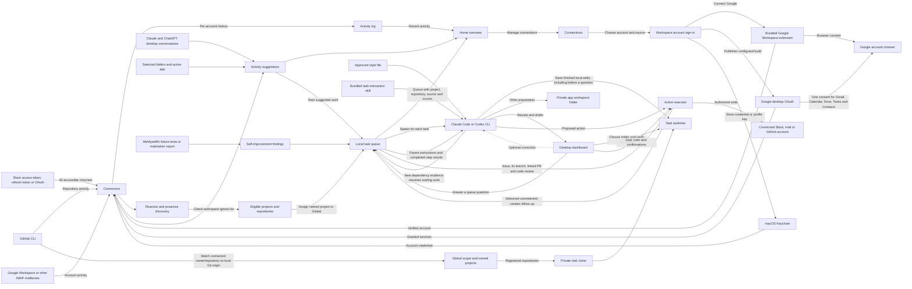

# Autonomous personal agent

The goal is an agent that can take care of all the user's tasks from discovery through completion. Email, Slack, and GitHub are its first sources of work. It picks up incoming requests and spots follow-ups in older activity. The dashboard lets the user see what the agent has done, correct its judgment, and help when it gets stuck. As the agent handles familiar work reliably, routine tasks should need no supervision.

For example, a teammate asks for a status update in Slack. The agent finds the linked GitHub issue, reads its latest update, and drafts a reply before the user opens the dashboard. In the initial dry-mode workflow, it waits for confirmation before posting. The longer-term goal is for the user to grant authority for routine replies so the agent can post, verify delivery, and record the outcome on its own.

## Proposed architecture

The executor applies dry mode and the user's rules for each project and decision type. A promise in a delivered message creates a task of its own. Each task agent checks its completion criteria and records evidence in the dashboard.

## Documentation

The first project for this workflow is MeMyselfAI itself. Tasks can test the app, track findings and prepare fixes and reviews in its own repository. [Self-improvement workflow](specs/self-improvement.md)

- [User stories](user-stories.md) describe what the user can delegate and when they might intervene.
- [Task discovery, preparation, and approval](specs/task-workflow.md) is the draft behavioral spec for the first workflow.
- [Task agents and completion](specs/task-execution.md) defines isolation, follow-ups, and the evidence needed to close bugs and emails.
- [Decision rules, writing style, and trust](specs/delegation-and-style.md) defines when agents may act, how they learn the user's voice, and how the user decides to leave dry mode.
- [Reviewing activity and learning from missed work](specs/activity-and-improvement.md) shows how an in-app report triggers recovery and improves future discovery using Markdown skills.
- [Repository rules](../AGENTS.md) describe how to take a change from spec to verification.

## Running the desktop implementation

The macOS app includes the task queue, source polling, Claude Code and Codex CLI workers, isolated Git worktrees, review and delivery, project rules, and Markdown revision history. Setup and build commands are in the [README](../README.md). The [desktop runtime](specs/desktop-runtime.md), [dashboard](specs/dashboard.md), [local agent](specs/local-agent.md), and [connector contracts](specs/connectors.md) describe this implementation.

Coverage depends on the connected accounts and their permissions. Slack covers accessible workspace channels. Google covers granted Workspace services and supports reviewed deadline events. GitHub CLI covers the account’s repositories. Catch-up reports show source gaps. Normal discovery resumes from the last successful sync after sleep or downtime.
