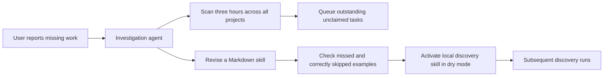

# Reviewing activity and learning from missed work

**Status** — Draft. Covers [US-15 and US-16](../user-stories.md).

## Review what happened

From the dashboard, the user can inspect each agent's activity, including the activity it read, work it picked up or skipped, decisions, questions, tool calls and outcomes, local edits, proposed and delivered messages, failures, and changes to skills. Link each entry to its task or discovery run, agent, project, relevant source, and resulting artifact where available. Show the reason for a skip or decision. A discovery run that creates zero tasks is still reviewable. Keep credentials out of the history.

## Report a miss

The user can describe missing work in their own words, from an activity entry or directly in the dashboard. Submitting the report spawns an agent to investigate. It traces relevant activity and prior decisions, explains why the work was missed where the evidence supports an explanation, and searches for other outstanding tasks affected by the same gap. Recovered tasks enter normal scheduling with deduplication and ownership checks. Link them to the report so the user can see what was recovered and which sources the agent could check.

Search all workspace connections across projects for additional missed events in the three hours ending when the user submitted the report. Use event timestamps and include both endpoints. Keep this interval fixed across projects, pages of results, and retries. Show the interval and any gaps in source coverage in the report.

The same agent identifies a durable improvement. For example, if discovery overlooked requests phrased as “could you take a look?”, the agent can revise a discovery skill, replay it against the missed request, and check that a similar thread already claimed by a teammate still gets skipped. If access to a source was the cause, surface that dependency and ask the user through the decision agent.

## Change behavior through Markdown

The app loads local skills and supporting Markdown instructions at runtime. In dry mode, the investigation agent applies local workflow improvements as soon as they are ready. The next run uses the active revision. The dashboard shows the diff, supporting examples, and which runs used it, so the user can review or revert it afterward. These changes take effect without an app update. Standing writing-style changes still require approval, whether inferred or explicitly requested. The executor continues to enforce dry mode and user-defined authority.

## Acceptance criteria

- From a skipped Slack request, the user can see the source, decision, agent, and reason. From a sent reply, the user can trace the draft, authorization, and delivery result.
- Reporting a missed request starts an investigation agent. If it finds two outstanding requests, one already queued, only the missing one gets a new task. Work already owned by someone else stays skipped.
- Given a report at 15:00 about Slack in project A, the scan also finds a matching unclaimed GitHub request at 12:00 in project B. An event at 11:59 is outside the window. A retry at 16:00 still scans 12:00 through 15:00 across all projects.
- In dry mode, a fresh run picks up the revised discovery skill before the user opens the review. Its history identifies the revision. After the user reverts it, the next run uses the previous revision. A suggested standing style change stays pending until approved.
