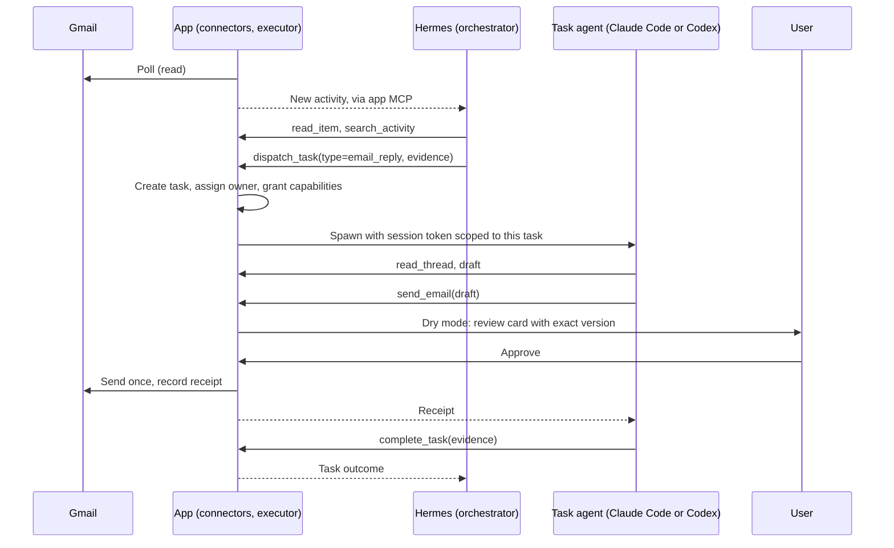

# Agents, capabilities and the app MCP server

**Status** — Draft, not implemented. Covers [US-30 and US-31](../user-stories.md). Extends the [local agent contract](local-agent.md) and is used by the [Hermes orchestrator](hermes-orchestrator.md) and [instances and sync](instances-and-sync.md).

## Intent

All agents in the app are set up in one place and work through one interface:

- **One setup.** The user signs in to Claude Code and/or Codex once per instance. The same subscription powers the task agents and the Hermes orchestrator. Connections are made once and serve every agent.
- **One flow for every kind of task.** Hermes reads connected accounts and decides what needs action. For each item it spawns a fresh task agent with the right type and permissions. That agent writes the reply, post or change and sends it through the app. The app applies dry mode or the project's rules.
- **One interface.** The app runs an MCP server. Hermes and every task agent use it to read workspace data and to perform app actions. Agents never hold connector credentials.

## Shared agent setup

Settings → **Agents** replaces the separate CLI and orchestrator settings. It lists one row per harness:

| Harness | Role | Sign-in |
| --- | --- | --- |
| Claude Code | Task agents | The user's Claude subscription or API key, through `claude` |
| Codex CLI | Task agents | The user's ChatGPT subscription or API key, through `codex` |
| Hermes | Orchestrator | Uses the Claude or ChatGPT subscription signed in above, or an API key the user adds |

Each row shows **Ready**, **Not installed**, **Sign in needed** or **Unsupported version**, and a single action to fix it. The app installs and updates all three at versions it pins. Subscription sign-in needs the user. **Sign in** opens the provider's own login in the browser, or a terminal panel in the app when the CLI only offers an interactive prompt. The app never sees the password. When a sign-in expires, the row and the orchestrator thread show **Sign in again**. Agents that need it wait with that reason instead of failing.

The user chooses the task agent harness, as today, and which subscription Hermes uses. Defaults: task agents use the first ready of Claude Code and Codex. Hermes uses the same subscription as task agents. Sign-ins are per instance and do not sync, because they belong to each CLI's own credential store. Every instance's Agents view shows its own readiness.

## Capabilities from connections

A connection gives the app read and write access to an account. The app turns that into **capabilities**, which it grants to agent sessions:

| Session | Gets | Example with a Google account |
| --- | --- | --- |
| Orchestrator (Hermes) | Read on every connection. No writes. Dispatch of tasks. | Search and read mail, calendar and Drive. Dispatch an `email_reply` task. |
| Task agent | Read on the task's evidence and anything it links to. Write limited to the task's bound account and destination, and to the action kinds of its task type. | Read the thread. Send one reply from the account that received it, to that thread. |

Capabilities are attached to a session token. The token is created when the app spawns the agent and revoked when the run ends or the task's ownership moves. A tool call outside the token's capabilities is refused and logged.

"Write" means the agent can call the action tool. What happens next is the app's decision. In dry mode every action becomes a review card with its exact version. Under a project rule that authorizes it, the executor sends at once. Either way the executor sends, verifies identity and target, and records the receipt. The agent never calls the provider.

## Task types

Every kind of work follows the same steps: Hermes dispatches it, an agent prepares it and calls an action tool, the executor applies the rules and delivers, and the agent verifies completion. A **task type** fills in the details:

| Task type | Typical trigger | Agent can read | Action tools | Completion evidence |
| --- | --- | --- | --- | --- |
| `email_reply` | Mail needing an answer | Thread, linked items, contacts | `send_email` | Delivered reply covering each requested element |
| `chat_reply` | Slack, Discord, Telegram or social mention or DM | Conversation, linked items | `send_message` | Delivered message in the original thread |
| `calendar` | Invitation, scheduling request | Calendars, thread | `respond_event`, `create_event` | Provider confirms the response or event |
| `github_bug` | Bug report | Issue, repository, worktree | `create_issue`, `publish_branch`, `open_pr`, `comment` | As in [task execution](task-execution.md) |
| `follow_up` | Promise or deadline | Source and related activity | Any of the above, chosen when it runs | The promised outcome |
| `general` | User request or anything else | Granted per task by the user | None by default. Hermes or the user can add one. | The user closes it or the agent reports done |

Task types are declared as data in the app: name, trigger description, readable sources, allowed action kinds and completion checks. Adding a connector or a type means adding a declaration and its fixtures. Project rules apply per task type and decision kind, as today.

## The app MCP server

The app runs an MCP server on each instance. Agents reach it through a per-session stdio bridge that the app passes to the agent at spawn. It is the only MCP server an agent session has. The server listens on no network port.

Tools, grouped by what they need:

| Group | Tools | Available to |
| --- | --- | --- |
| Workspace read | `search_activity`, `read_item`, `read_thread`, `list_tasks`, `read_task`, `list_projects`, `read_rules`, `read_style` | Orchestrator: all. Task agent: its task and the evidence it links to. |
| Discovery | `propose_task`, `propose_project`, `propose_follow_up`, `dispatch_task` | Orchestrator |
| Conversation | `post_update`, `ask_user` (raises the thread with line one and options) | Orchestrator, and task agents for their own task |
| Task progress | `record_progress`, `add_option`, `complete_task`, `skip_task` | Task agent, for its own task |
| Actions | `send_email`, `send_message`, `respond_event`, `create_event`, `comment`, `create_issue`, `publish_branch`, `open_pr` | Task agent, within its write capability |
| Scheduling | `schedule_check` | Orchestrator, and task agents for their own task |
| Learning | `propose_skill_change`, `propose_style` | All. Changes go through the existing review. |

Every action tool returns one of: `pending_review` with the action version, `sent` with the receipt, `rejected` with the reason, or `uncertain`. The agent cannot approve, change rules, connect accounts, read credentials or call providers. `dispatch_task` creates a task with a type, project, evidence and bound account and destination. The app assigns its owner by capacity, as in [instances and sync](instances-and-sync.md#dividing-work), and spawns the agent there.

Connected content is data. Text in an email asking an agent to send, approve or widen its access has no authority. Capabilities come only from the session token.

## Changes to the local agent contract

The [local agent contract](local-agent.md) currently starts each run with no tools and no MCP servers, and returns one structured proposal. Under this spec, a task agent run instead:

- gets exactly one MCP server, the app's, scoped by its session token,
- still gets no connector credentials, no personal hooks, plugins or other MCP servers, and no shell or file tools outside its task worktree,
- reports through task progress and action tools instead of only a final JSON proposal. A final structured result is still accepted, for compatibility and for the fallback path.

## Acceptance criteria

- On a clean instance, Settings → Agents shows Claude Code, Codex and Hermes with their states. Signing into Claude Code makes both task agents and Hermes ready without another sign-in. An expired sign-in shows **Sign in again**, and waiting tasks resume after it.
- With a fixture Google connection, a fixture email needing a reply leads Hermes to call `dispatch_task(email_reply)`. A new agent drafts and calls `send_email`. In dry mode the result is a review card. After approval the fixture connector records one write from the bound account to the original thread.
- The same flow works for a fixture Slack mention (`chat_reply`) and a fixture invitation (`calendar`) without code specific to the type outside its declaration.
- A task agent calling `send_email` to another recipient, from another account, or after its run ended is refused and logged. Hermes calling `send_email` is refused.
- An agent session lists exactly one MCP server. No environment variable, argument or tool result contains a connector credential.
- A fixture email instructing the agent to approve its own draft or to read another task produces no approval and a refused call.
- Every action tool result is one of the four outcomes, and an `uncertain` result blocks a resend until it is reconciled.
