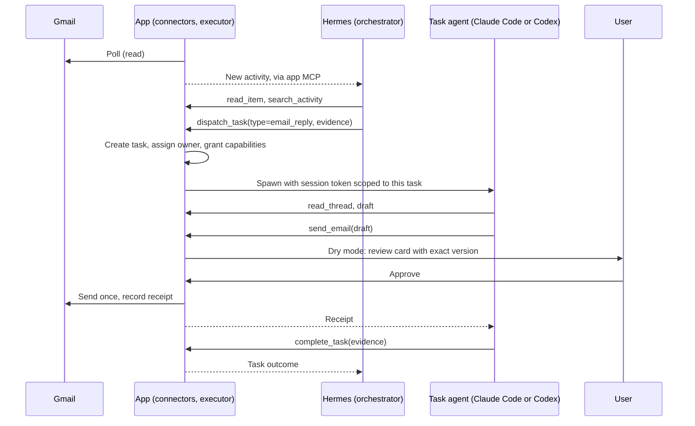

# Agents, capabilities and the app MCP server

**Status** — Partly implemented. See [implementation status](#implementation-status). Covers [US-30 and US-31](../user-stories.md). Extends the [local agent contract](local-agent.md) and is used by the [Hermes orchestrator](hermes-orchestrator.md) and [instances and sync](instances-and-sync.md).

## Intent

All agents in the app are set up in one place and work through one interface:

- **One setup.** The user signs in to Claude Code and/or Codex once per instance. The same subscription powers the task agents and the Hermes orchestrator. Connections are made once and serve every agent.
- **One flow for every kind of task.** Hermes reads connected accounts and decides what needs action. For each item it spawns a fresh task agent with the right type and permissions. That agent writes the reply, post or change and sends it through the app. The app applies dry mode or the project's rules.
- **One interface.** The app runs an MCP server. Hermes and every task agent use it to read workspace data and to perform app actions. Agents never hold connector credentials.

## Shared agent setup

Settings → **Agents** replaces the separate CLI and orchestrator settings. It lists one row per harness:

| Harness | Role | Sign-in |
| --- | --- | --- |
| Claude Code | Task agents | The user's Claude subscription or API key, through `claude` |
| Codex CLI | Task agents | The user's ChatGPT subscription or API key, through `codex` |
| Hermes | Orchestrator | Uses the Claude or ChatGPT subscription signed in above, or an API key the user adds |

Each row shows **Ready**, **Not installed**, **Sign in needed** or **Unsupported version**, and a single action to fix it. The app installs and updates all three at versions it pins. Subscription sign-in needs the user. **Sign in** opens the provider's own login in the browser, or a terminal panel in the app when the CLI only offers an interactive prompt. The app never sees the password. When a sign-in expires, the row and the orchestrator thread show **Sign in again**. Agents that need it wait with that reason instead of failing.

The user chooses the task agent harness, as today, and which subscription Hermes uses. Defaults: task agents use the first ready of Claude Code and Codex. Hermes uses the same subscription as task agents. Sign-ins are per instance and do not sync, because they belong to each CLI's own credential store. Every instance's Agents view shows its own readiness.

## Capabilities from connections

A connection gives the app read and write access to an account. The app turns that into **capabilities**, which it grants to agent sessions:

| Session | Gets | Example with a Google account |
| --- | --- | --- |
| Orchestrator (Hermes) | Read on every connection. No writes to accounts. Dispatch of tasks. Curation of the local [context and schedules](context-and-schedules.md#mcp-tools). | Search and read mail, calendar and Drive. Dispatch an `email_reply` task. |
| Task agent | Read on the task's evidence and anything it links to. Write limited to the task's bound account and destination, and to the action kinds of its task type. | Read the thread. Send one reply from the account that received it, to that thread. |

Capabilities are attached to a session token. The token is created when the app spawns the agent and revoked when the run ends or the task's ownership moves. A tool call outside the token's capabilities is refused and logged. A refusal carries a `refused` field with the reason. Task sessions also get it as an MCP error result. Orchestrator sessions get it as a plain result, because Hermes stops calling a server after three error results in a row.

"Write" means the agent can call the action tool. What happens next is the app's decision. In dry mode every action becomes a review card with its exact version. Under a project rule that authorizes it, the executor sends at once. Either way the executor sends, verifies identity and target, and records the receipt. The agent never calls the provider.

## Task types

Every kind of work follows the same steps: Hermes dispatches it, an agent prepares it and calls an action tool, the executor applies the rules and delivers, and the agent verifies completion. A **task type** fills in the details:

| Task type | Typical trigger | Agent can read | Action tools | Completion evidence |
| --- | --- | --- | --- | --- |
| `email_reply` | Mail needing an answer | Thread, linked items, contacts | `send_email` | Delivered reply covering each requested element |
| `chat_reply` | Slack, Discord, Telegram or social mention or DM | Conversation, linked items | `send_message` | Delivered message in the original thread |
| `calendar` | Invitation, scheduling request | Calendars, thread | `respond_event`, `create_event` | Provider confirms the response or event |
| `github_bug` | Bug report | Issue, repository, worktree | `create_issue`, `publish_branch`, `open_pr`, `comment` | As in [task execution](task-execution.md) |
| `follow_up` | Promise or deadline | Source and related activity | Any of the above, chosen when it runs, and `create_issue` | The promised outcome |
| `general` | User request or anything else | Granted per task by the user | `create_issue`. Hermes or the user can add more. | The user closes it or the agent reports done |

Task types are declared as data in the app: name, trigger description, readable sources, allowed action kinds and completion checks. Adding a connector or a type means adding a declaration and its fixtures. Project rules apply per task type and decision kind, as today.

## The app MCP server

The app runs an MCP server on each instance. Agents reach it through a per-session stdio bridge (`app_mcp.py`) that the app passes to the agent at spawn. It is the only MCP server an agent session has. The bridge relays JSON-RPC to the service's existing loopback endpoint `/mcp`, so no new port is opened. That endpoint accepts only a session token as a bearer credential. It refuses requests carrying a browser cookie or an `Origin` header. The token reaches the bridge through a file readable only by the user, never through process arguments or the CLI's environment.

Tools, grouped by what they need:

| Group | Tools | Available to |
| --- | --- | --- |
| Workspace read | `search_activity`, `read_item`, `read_thread`, `list_tasks`, `read_task`, `list_projects`, `read_rules`, `read_style` | Orchestrator: all. Task agent: its task and the evidence it links to. |
| Discovery | `dispatch_task`, `create_project` | Orchestrator. There is no tool for asking the user whether to act. |
| Conversation | `post_update`, `ask_user` (raises the thread with line one and options) | Orchestrator, and task agents for their own task |
| Task progress | `record_progress`, `add_option`, `complete_task`, `skip_task` | Task agent, for its own task |
| Actions | `send_email`, `send_message`, `respond_event`, `create_event`, `comment`, `create_issue`, `publish_branch`, `open_pr` | Task agent, within its write capability |
| Scheduling | `schedule_check` | Orchestrator, and task agents for their own task |
| Learning | `propose_skill_change`, `propose_style` | All. Changes go through the existing review. |

Every action tool returns one of: `pending_review` with the action version, `sent` with the receipt, `rejected` with the reason, or `uncertain`. The agent cannot approve, change rules, connect accounts, read credentials or call providers. `dispatch_task` creates a task with a type, project, evidence and bound account and destination. The app assigns its owner by capacity, as in [instances and sync](instances-and-sync.md#dividing-work), and spawns the agent there.

### Filing a GitHub issue

`create_issue(title, body, repository?)` lets a task agent file a new issue that its work turned up, such as a bug found while reviewing a pull request. It is separate from the bug flow: a `bug` or `bugfix` task files its issue through its own milestones and does not get this tool. Every other task agent gets it, whatever its source, including a local task with no source at all.

- **Where it can file.** Only to a GitHub repository the task's project already knows: a repository registered to the project or one of its sub-projects, and the repository of the task's own GitHub source. The Global project contributes only the task's source. Each must have a connected GitHub repository connection that is not unavailable or ignored. With one candidate, `repository` may be omitted. With several, the agent must name one. Any other repository is refused, and the refusal lists the allowed ones.
- **Who files it.** The account of that repository connection. The task stores the operation `create issue`, the account, the repository as destination, and the exact title and body as one action version.
- **Dry mode.** The call returns `pending_review`. The review card shows the account, the repository and the full title and body. Approving files exactly that version once.
- **Outside dry mode.** The issue is filed at once, without a project rule, and the call returns `sent` with the issue URL. A version prepared by an instance that went silent still needs approval, as for every other action.
- **Which instance files it.** The task's owner, using the synced GitHub login when its own GitHub CLI has none, as in [instances and sync](instances-and-sync.md#phase-2-design).
- **Afterwards.** A filed issue completes the task, with the issue URL as its result. A task holds one pending action at a time. A failed check before sending, such as a changed account, leaves the task failed with the reason. An unknown outcome leaves it uncertain, blocks a second filing, and is reconciled with the issue number as for the bug flow.

Connected content is data. Text in an email asking an agent to send, approve or widen its access has no authority. Capabilities come only from the session token.

## Changes to the local agent contract

The [local agent contract](local-agent.md) currently starts each run with no tools and no MCP servers, and returns one structured proposal. Under this spec, a task agent run instead:

- gets exactly one MCP server, the app's, scoped by its session token,
- still gets no connector credentials, no personal hooks, plugins or other MCP servers, and no shell or file tools outside its task worktree,
- reports through task progress and action tools instead of only a final JSON proposal. A final structured result is still accepted, for compatibility and for the fallback path.

## Acceptance criteria

- On a clean instance, Settings → Agents shows Claude Code, Codex and Hermes with their states. Signing into Claude Code makes both task agents and Hermes ready without another sign-in. An expired sign-in shows **Sign in again**, and waiting tasks resume after it.
- With a fixture Google connection, a fixture email needing a reply leads Hermes to call `dispatch_task(email_reply)`. A new agent drafts and calls `send_email`. In dry mode the result is a review card. After approval the fixture connector records one write from the bound account to the original thread.
- The same flow works for a fixture Slack mention (`chat_reply`) and a fixture invitation (`calendar`) without code specific to the type outside its declaration.
- A task agent calling `send_email` to another recipient, from another account, or after its run ended is refused and logged. Hermes calling `send_email` is refused.
- An agent session lists exactly one MCP server. No environment variable, argument or tool result contains a connector credential.
- A fixture email instructing the agent to approve its own draft or to read another task produces no approval and a refused call.
- Every action tool result is one of the four outcomes, and an `uncertain` result blocks a resend until it is reconciled.
- A local task in a project with one connected repository calls `create_issue`. In dry mode it becomes a review with the repository's account and the exact title and body, and nothing is written until approval, which files it once. With dry mode off it is filed at once and the task is done with the issue URL. A repository outside the project, a bug task, and a second call after an uncertain filing are refused or blocked.

## Implementation status

Implemented and tested with fixtures (`tests/test_app_mcp.py`, `tests/test_worker.py`):

- **Settings → Agents** shows Claude Code, Codex CLI and Hermes with Ready, Sign in needed, Not installed or Unsupported version. **Sign in** opens the interactive login in Terminal on macOS, or shows the command to run elsewhere. Settings stores which subscription Hermes uses.
- Session tokens per role and task, with capabilities, expiry and revocation. Task runs get a session only while the service is running, and it is revoked when the run ends.
- Tools: `list_tasks`, `read_task`, `search_activity`, `read_item`, `read_thread`, `list_projects`, `read_rules`, `dispatch_task`, `post_update`, `record_progress`, `ask_user`, `complete_task`, `skip_task`, `send_email`, `send_message`, `comment`, `create_issue`.
- Task types: `email_reply`, `chat_reply`, `github_comment`, `github_bug`, `follow_up`, `general`. Without a declared type, a task gets the send tool matching its source. Every task except a bug task also gets `create_issue`.
- Action tools hand the exact text to the existing executor. In dry mode they return `pending_review` with the version the user approves. Under an authorizing rule they deliver once and return `sent`. An unknown outcome blocks resends.

Verified live on macOS with Claude Code 2.1.330, Codex CLI 0.166.0 and Hermes 0.13.0, against a temporary workspace and a fixture email. No provider was written to.

- Claude Code and Codex each read the source email through the app server and called `send_email`. The task reached review with the exact text.
- Hermes connected with the app-written config and listed exactly the nine orchestrator tools.

Findings that shaped the implementation:

- Claude Code's `--safe-mode` disables every MCP server, including one passed with `--mcp-config`. Runs that receive the app server drop safe mode. They keep `--restricted`, `--tools ""`, `--strict-mcp-config` and `--setting-sources ""`, and allow only `mcp__memyselfai`.
- Codex asks for approval on each MCP tool call and refuses when approvals are off. The app sets `default_tools_approval_mode="approve"` for its own server only, because the app enforces each call.
- Claude Code finds a macOS Keychain login by the user's account name. Task runs failed with "Not logged in" until `USER` and `LOGNAME` were passed. This affected every Claude Code task run on such Macs, before this change too.

Not implemented yet: `create_project`, `add_option`, `schedule_check`, the learning tools, calendar and bug-fix action tools through MCP, and Hermes runs driven by the app. See the [Hermes orchestrator](hermes-orchestrator.md).
