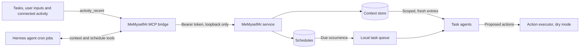

**Status** — Implementation contract for [US-35, US-36 and US-37](../user-stories.md). Meeting transcripts and collaborators are recorded as planned work below and are not implemented.

# Shared context and schedules managed by Hermes

Each task agent starts fresh. Without shared context, every agent relearns who people are, what was promised and how the user likes things done. MeMyselfAI keeps a local **context store** that agents draw on. The [Hermes agent](https://github.com/NousResearch/hermes-agent) acts as its steward. Hermes reads recent work, records lasting context, retires stale context and manages **schedules**, which are recurring tasks. Hermes reaches the app only through a narrow MCP bridge.

## Who owns what

- **The app** owns the data. Only one process may open a workspace, so Hermes never touches the database directly. Context entries and schedules are app records, visible in the dashboard and kept when Hermes is offline. Due schedules fire from the app's scheduler.
- **Hermes** owns judgment about context and timing. Its scheduled jobs create, refresh and retire context entries. They also create and cancel schedules based on what the user asked for and what the context implies.
- **The MCP bridge** owns access. Hermes receives the curator tools listed below. Task agents receive only the entries the app selects for their task, so they never get a tool connection.

Hermes's tools cannot send anything. A schedule only enqueues a local task. That task then goes through the normal [task workflow](task-workflow.md), and dry mode and [decision rules](delegation-and-style.md) still gate every external write. Connected content that Hermes reads is untrusted input. At worst it can produce a wrong context entry or schedule. The user can see and undo both, and neither can authorize a write.

## Context store

An entry has a kind (`person`, `project`, `commitment`, `preference` or `fact`), a subject, a body, a project, its supporting sources, an author (`hermes` or `user`), a status and a review date. Saving an entry with the same kind, subject and project updates it in place.

Each entry is due for review after a period that depends on its kind. Commitments are reviewed after 14 days, facts after 30, and people, projects and preferences after 90. Hermes may choose 1 to 365 days. An active entry past its review date is **stale**. Stale entries stay visible but are withheld from task agents until Hermes refreshes or retires them. Retiring keeps the entry and its reason in history. The user can also retire or restore an entry from the dashboard.

### Access by task agents

For each task, discovery and decision request, the app attaches up to 8 entries, totalling at most 8 KB. Entries must be active, not stale, and belong to the request's project, one of its parent projects or Global. Entries from unrelated projects are never supplied. Entries are ranked by word overlap with the request. The activity log records which entry IDs were supplied, so the user can trace what an agent knew.

## Schedules

A schedule has a title, a body, a project, a timing, an origin (`user` when the user asked for it, `inferred` when Hermes derived it from context), a reason and a status (`active`, `cancelled` or `done`). Timing is either a local time with weekdays (for example 09:00 on Monday) or a single moment.

- When an occurrence is due, the app creates a local task with source **Schedule** that links to the schedule, then computes the next local occurrence. A one-time schedule becomes `done`.
- If the previous task from the same schedule is still open, the app skips the occurrence and logs why. Duplicate runs never pile up.
- After the app was closed, a schedule fires once for the missed time, not once per missed occurrence.
- Hermes creates schedules when the user asks for recurring work, for example "every Friday send me a summary of open PRs." It may also create them from context, such as a standing commitment to send weekly figures. The dashboard shows the origin, reason and next run.
- Hermes cancels schedules that no longer apply, giving a reason. The user can cancel any schedule. Hermes cannot create a schedule matching the title and project of one the user cancelled.

## Hermes jobs

`scripts/connect-hermes.sh` registers the bridge with Hermes and creates two Hermes cron jobs with local delivery:

| Job | When | Does |
| --- | --- | --- |
| `memyselfai-context` | Hourly | Reads `activity_recent`, records lasting context, and creates or cancels schedules from user requests and inferred commitments |
| `memyselfai-cleanup` | Daily at 07:00 | Reviews `context_stale`, then refreshes or retires each entry. Retires context about finished work and cancels inferred schedules whose reason no longer holds |

The dashboard shows when Hermes last used the bridge. If Hermes is not connected, everything else works as before, but no context is added.

## MCP tools

| Tool | Effect |
| --- | --- |
| `activity_recent(hours)` | Recent tasks (with user feedback and answers), up to 72 hours of connected events (truncated) and schedules |
| `context_search(query, project, include_stale)` | Matching entries |
| `context_save(kind, subject, body, project, sources, review_after_days)` | Create or refresh an entry |
| `context_retire(id, reason)` | Retire an entry |
| `context_stale()` | Active entries past review |
| `schedule_list()` | All schedules |
| `schedule_create(title, body, project, time, days \| once_at, origin, reason)` | Create a schedule |
| `schedule_cancel(id, reason)` | Cancel a schedule |

The bridge is a stdio MCP server (`hermes_mcp.py`, data directory from `MEMYSELFAI_DATA` or `--data`). It reads the service's loopback port and a workspace token from `hermes.json` in the data directory, which is readable only by the user, and forwards tool calls to `POST /hermes/tool`. Requests without the token, or from another host, are rejected. Every write is logged in Activity with the prefix **Hermes**.

## Handoff candidates

To decide when to grant authority, it helps to know which work is ready for it. **Decision rules** lists each project and decision type that is still under review once it has at least 5 delivered tasks in the last 30 days, none of which the user corrected, and no missed-work report in that project in that period. The listing shows these counts, and **Allow autonomous handling** sets the rule. This is evidence, not authority. Only the user changes a rule, and dry mode still overrides it. This extends [Leaving dry mode](delegation-and-style.md#leaving-dry-mode).

## Skill revisions are tested before activation

A discovery revision proposed by a [missed-work investigation](activity-and-improvement.md) is replayed before it becomes active. The replay uses the two most recent completed tasks that came from connected events. If the revision rejects any of these accepted examples, it stays inactive with status **failed check**, and the activity log names the failing example. The current revision stays active.

## Acceptance criteria

- With Hermes's token, `context_save` creates an entry and a second save with the same kind, subject and project updates it. Without the token, or with another Host header, the request receives 403.
- A task in project B never receives an entry from sibling project A. It receives entries from B, from B's parent and from Global. A stale entry is withheld until `context_save` refreshes it. The log lists the supplied IDs.
- A schedule for 09:00 on weekdays, created on Friday at 10:00, first runs on Monday at 09:00 local time. Its task appears with source Schedule. If that task is still open at the next occurrence, no second task is created.
- After the user cancels a schedule, `schedule_create` with the same title and project is refused. Hermes can cancel an inferred schedule with a reason that appears in Activity.
- The MCP bridge answers `initialize`, `tools/list` and `tools/call` over stdio, and returns a tool error when the app is not running.
- A discovery revision that rejects an accepted example stays inactive, and the previous revision keeps running.
- A project and decision type with 5 uncorrected deliveries and no reported miss appears as a handoff candidate. One correction removes it.

## Planned, not implemented

### Meeting transcripts

Meeting transcripts are the richest source of context. They capture spoken promises, decisions and who owns what, and today MeMyselfAI misses all of it. Calendar events are read but have no notes. A later version should ingest transcripts from a meeting recorder or the user's local recordings as a connected source. Each meeting would link to its calendar event, its attendees (person entries) and its project. Promises made in a meeting would become follow-ups, the same way as [commitments in delivered messages](task-execution.md#promises-become-work). Open questions include which recorders to support, consent for recording other participants, and whether transcription runs locally.

### Collaborators

MeMyselfAI targets a single user. These additions would let it work with collaborators later:

- **Shared context with permissions.** Context entries would get sharing groups, and some fields would have row- or field-level visibility. For example, a teammate's agent could read project facts but not the user's private preferences.
- **Shared schedules and skills.** A recurring job, such as a weekly release digest, would be owned by a team. Its skill revisions, test results and run history would be visible to everyone it serves. This is what the Notion essay calls a "factory."
- **Delegation to people.** Tasks could be assigned to a teammate, with ownership checks extending beyond "someone else claimed it" to an explicit handoff.
- **Approval by someone else.** Some decision types could require a named reviewer instead of the user.
- **Team onboarding.** A new teammate would start from a team's preset rules, skills and schedules instead of configuring their own.

None of these change the current single-user contract. Credentials and private activity stay on the user's machine.
