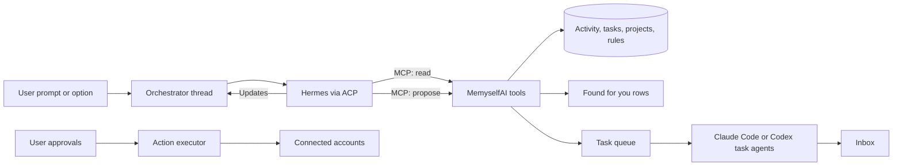

# Hermes orchestrator

**Status** — Draft, not implemented. Covers [US-23, US-24 and US-30](../user-stories.md). Runs the passes in [proactive discovery](proactive-discovery.md). Task workers stay as described in the [local agent contract](local-agent.md).

## Intent

One long-lived agent watches the whole workspace. It discovers work, proposes tasks and projects, keeps track of what is running, and answers the user. The user can prompt it in plain language and get updates from it. That agent is [Hermes Agent](https://github.com/NousResearch/hermes-agent) by Nous Research. Hermes is MIT licensed and has persistent memory, self-improving skills, scheduled jobs, subagents, MCP tools and an Agent Client Protocol (ACP) server.

Hermes is part of the product. The user never installs, configures or updates it by hand. The app does that and keeps it healthy. Per-task work still runs in fresh Claude Code or Codex processes, one per task. Hermes decides what should happen. Task agents do the work. The app enforces authority.

## What the app manages

| Concern | Behavior |
| --- | --- |
| Install | On first run and on each new instance, the app installs a Hermes version it pins, into its own data directory. It verifies the download's checksum and uses a private home (`HERMES_HOME`), so it never touches a `~/.hermes` the user already has. Progress and failures appear in Settings → Orchestrator, with a retry. |
| Configuration | The app writes Hermes' `config.yaml` from workspace settings. It overwrites any drift on start. |
| Model | Hermes needs a model provider of its own. Settings → Orchestrator offers the providers Hermes supports, such as Anthropic, OpenAI, OpenRouter or a local model. The provider key is stored in Keychain or the instance's encrypted store and passed to Hermes in its environment only. It is a per-instance sign-in and does not sync, like CLI sign-ins. |
| Process | The app starts `hermes acp` over stdio and acts as its ACP client. It restarts Hermes after a crash with backoff: 1, 5, 30 seconds, then every 5 minutes. After three crashes in 10 minutes it shows the error on the orchestrator row. |
| Health | On start and hourly, the app runs Hermes' own checks (`hermes acp --check`, `hermes doctor`). It also sends a short test prompt. Failures appear in Settings and the Instances view. |
| Updates | The app updates Hermes only to a version a MemyselfAI release has tested. It never runs `hermes update`. A failed update rolls back to the previous version. |
| Memory and skills | Hermes' `MEMORY.md`, `USER.md`, `SOUL.md` and skills live in the workspace Markdown store. They have revision history and sync between instances. Skill changes Hermes makes follow the existing [improvement review](activity-and-improvement.md). |
| One active copy | Every instance has Hermes installed. Only the instance holding the workspace's orchestrator lock runs it. See [instances and sync](instances-and-sync.md#locks). If that instance goes away, another takes the lock and starts Hermes with the synced memory and thread. |

## What Hermes can and cannot do

Hermes reaches the workspace only through a MemyselfAI MCP server that the app provides. All of its own tools that act outside that server are turned off:

- No terminal, file-write, browser or code-execution tools. Its messaging gateway, cron delivery to platforms and its HTTP API server are disabled.
- Its own approval setting is `manual`, with unattended mode set to `deny`. Any permission request it sends over ACP is denied by the app and logged.
- It receives no connector credentials and no other secrets in its environment, apart from its model key.
- Connected content is data. Text in an email asking Hermes to send, approve or connect something has no authority.

MemyselfAI MCP tools:

| Tool | Kind | Effect |
| --- | --- | --- |
| `search_activity`, `read_item`, `list_tasks`, `read_task`, `list_projects`, `read_rules` | Read | Bounded results with stable references |
| `propose_task`, `propose_project`, `propose_follow_up` | Propose | Creates a found row with evidence. Counts against the daily budget. |
| `start_task` | Propose | Queues a task only if a project rule allows starting that decision kind without triage. Otherwise creates a found row. |
| `update_thread` | Report | Posts a message to the orchestrator thread |
| `raise_to_inbox` | Report | Puts the orchestrator thread in Needs you with a line one and options |
| `schedule_check` | Plan | Asks the app to wake Hermes at a time with a stated purpose. The app runs these, because Hermes' own cron is off. |

There is no tool that approves, sends, edits a proposal, changes a rule, connects an account or reads a credential. Those stay with the user and the action executor.

## Talking to the orchestrator

- The orchestrator has one permanent thread, pinned at the top of the inbox list as **Orchestrator**. It counts as Needs you only when Hermes raises something.
- **⌘K → Ask the orchestrator**, or **R** on its row, sends a prompt. Examples: "What's on my plate this week?", "Pull everything about the Lisbon trip into a project", "Why is the invoice task stuck?", "Stop suggesting newsletter follow-ups."
- Hermes replies in the thread. A reply that proposes work ends with numbered options, as on any card. Picking an option calls the matching tool. Proposed writes still go through review.
- **Updates.** Each morning at a time the user sets (default 08:30), Hermes posts a digest: what it found, what finished, what is stuck, and what needs the user. It also posts when a task it proposed finishes or fails. The user can mute digests or change their time.
- Instructions the user gives become entries in Hermes' memory or skills. Both are shown with their revision history and can be reverted.

## Discovery passes

The reactive pass, the 15-minute sweep and the daily project pass in [proactive discovery](proactive-discovery.md) run as prompts to Hermes. Each prompt arrives on a schedule the app owns, under that pass's lock. Hermes reads through MCP tools and proposes through MCP tools. The budget, deduplication and dismissal learning in that spec are enforced by the app's tools, not left to Hermes. When Hermes is unavailable, the app falls back to the existing fresh-CLI discovery so discovery never stops. The orchestrator row says it is in fallback.

## Acceptance criteria

- On a clean macOS and a clean Linux instance, first run installs the pinned Hermes into the app's data directory and passes its health checks. An existing `~/.hermes` is unchanged.
- A failed download, bad checksum or failed health check shows in Settings with a retry. Discovery continues through the fallback.
- Killing the Hermes process restarts it with backoff. Three crashes in 10 minutes show an error on the orchestrator row.
- Hermes' effective configuration has terminal, file, browser, code execution, gateway, cron delivery and the HTTP server disabled. A fixture permission request over ACP is denied and logged.
- With fixture activity, Hermes' passes create found rows through `propose_task`. The budget and deduplication hold even when a fixture Hermes proposes 30 items.
- A fixture email telling the orchestrator to send a reply produces at most a proposal. The connector records zero writes.
- Asking "What's on my plate this week?" returns an answer grounded in fixture tasks, with references. Picking a proposed option creates the task.
- The morning digest posts once a day at the set time on whichever instance holds the orchestrator lock, including after the lock moves.
- Editing Hermes' memory on one instance appears on the other. Reverting a revision restores the earlier text.
- Updating to a broken fixture Hermes version rolls back automatically.

## Open questions

- Hermes needs its own model provider key. It is not documented that Hermes can use a Claude Code or Codex subscription sign-in. Its docs mention an optional "Codex app-server runtime" that has not been evaluated. Until that is verified, the user must supply an API key. Is that acceptable?
- Hermes' macOS desktop app supports Apple Silicon only. The command-line install also targets macOS. This spec uses only the command-line install. Intel Mac support needs testing.
- Should the orchestrator also be reachable from the user's own Telegram or Signal through Hermes' gateway? That would be a message sent by a third-party service, so it is off in this draft.
