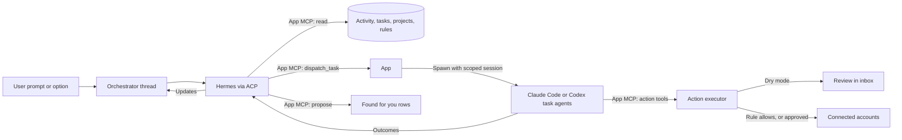

# Hermes orchestrator

**Status** — Draft, not implemented. Covers [US-23, US-24 and US-30](../user-stories.md). Runs the passes in [proactive discovery](proactive-discovery.md). Shares setup, capabilities and the app MCP server with every other agent, as described in [agents, capabilities and the app MCP server](agents-and-app-mcp.md).

## Intent

One long-lived agent watches the whole workspace. It reads connected accounts, decides what needs action, and dispatches each item to a freshly spawned task agent. It also proposes projects, keeps track of running work, and answers the user. The user can prompt it in plain language and get updates from it. That agent is [Hermes Agent](https://github.com/NousResearch/hermes-agent) by Nous Research. Hermes is MIT licensed and has persistent memory, self-improving skills, subagents, MCP tools and an Agent Client Protocol (ACP) server.

Hermes is part of the product. The user never installs, configures or updates it by hand. Hermes decides what should happen. Task agents in Claude Code or Codex do the work, one fresh agent per task. The app enforces authority and performs every send.

## What the app manages

| Concern | Behavior |
| --- | --- |
| Install | On first run and on each new instance, the app installs a Hermes version it pins, into its own data directory. It verifies the download's checksum and uses a private home (`HERMES_HOME`), so it never touches a `~/.hermes` the user already has. Progress and failures appear in Settings → Agents, with a retry. |
| Configuration | The app writes Hermes' `config.yaml` from workspace settings. It overwrites any drift on start. |
| Model | Hermes uses the user's Claude or ChatGPT subscription, the same one the task agents use. Connecting it may need the user to complete an interactive sign-in. The app opens it from Settings → Agents. An API key is an alternative. Sign-ins belong to each instance and do not sync. See [shared agent setup](agents-and-app-mcp.md#shared-agent-setup). |
| Process | The app starts `hermes acp` over stdio and acts as its ACP client. It restarts Hermes after a crash with backoff: 1, 5, 30 seconds, then every 5 minutes. After three crashes in 10 minutes it shows the error on the orchestrator row. |
| Health | On start and hourly, the app runs Hermes' own checks (`hermes acp --check`, `hermes doctor`). It also sends a short test prompt. Failures appear in Settings → Agents and the Instances view. An expired subscription sign-in shows **Sign in again**. |
| Updates | The app updates Hermes only to a version a MemyselfAI release has tested. It never runs `hermes update`. A failed update rolls back to the previous version. |
| Memory and skills | Hermes' `MEMORY.md`, `USER.md`, `SOUL.md` and skills live in the workspace Markdown store. They have revision history and sync between instances. Skill changes Hermes makes follow the existing [improvement review](activity-and-improvement.md). |
| One active copy | Every instance has Hermes installed. Only the instance that owns the orchestrator runs it, under the [ownership protocol](instances-and-sync.md#ownership-protocol). |

## What Hermes can and cannot do

Hermes reaches the workspace only through the [app MCP server](agents-and-app-mcp.md#the-app-mcp-server), with the orchestrator's capabilities:

- **Can** read every connection through the app, propose tasks and projects, dispatch tasks of any declared type, post updates, ask the user, and schedule its own checks.
- **Cannot** call any action tool, so it cannot send, post, comment or change anything outside the app. It cannot approve, change rules, connect accounts or see credentials.
- Its own terminal, file-write, browser and code-execution tools are off. Its messaging gateway, cron delivery to platforms and HTTP API server are disabled. Its approval setting is `manual`, with unattended mode set to `deny`. Any permission request it sends over ACP is denied by the app and logged.
- Connected content is data. Text in an email asking Hermes to send, approve or connect something has no authority.

## Dispatching work

When Hermes decides that an item needs action, it calls `dispatch_task` with a task type, project, evidence and the account and destination the work is bound to. The app then:

1. checks that a project rule allows starting this type and decision kind without triage. If not, it creates a found row instead, for the user to accept.
2. creates the task and assigns an owner instance by capacity, as in [dividing work](instances-and-sync.md#dividing-work).
3. spawns a fresh task agent on the owner, with a session token scoped to that task's evidence and write capability.
4. reports the outcome back to Hermes when the task finishes, waits for the user, or fails.

This is the same for every task type: email replies, chat replies, calendar responses, bug fixes and follow-ups. Each type's details live in its [declaration](agents-and-app-mcp.md#task-types).

## Talking to the orchestrator

- The orchestrator has one permanent thread, pinned at the top of the inbox list as **Orchestrator**. It counts as Needs you only when Hermes raises something.
- **⌘K → Ask the orchestrator**, or **R** on its row, sends a prompt. Examples: "What's on my plate this week?", "Pull everything about the Lisbon trip into a project", "Why is the invoice task stuck?", "Stop suggesting newsletter follow-ups."
- Hermes replies in the thread. A reply that proposes work ends with numbered options, as on any card. Picking an option calls the matching tool.
- **Updates.** Each morning at a time the user sets (default 08:30), Hermes posts a digest: what it found and dispatched, what finished, what is stuck, and what needs the user. It also posts when a task it dispatched finishes or fails. The user can mute digests or change their time.
- Instructions the user gives become entries in Hermes' memory or skills. Both are shown with their revision history and can be reverted.

## Discovery passes

The reactive pass, the 15-minute sweep and the daily project pass in [proactive discovery](proactive-discovery.md) run as prompts to Hermes. The app sends them on its own schedule. Budget, deduplication and dismissal learning are enforced by the app's tools, not left to Hermes. When Hermes is unavailable, the app falls back to the existing fresh-CLI discovery, which only proposes found rows. The orchestrator row says it is in fallback.

## Acceptance criteria

- On a clean macOS and a clean Linux instance, first run installs the pinned Hermes into the app's data directory. After the user signs into Claude Code or Codex, Hermes passes its health checks with that subscription, with no API key. An existing `~/.hermes` is unchanged.
- A failed download, bad checksum, failed health check or expired sign-in shows in Settings → Agents with the fixing action. Discovery continues through the fallback.
- Killing the Hermes process restarts it with backoff. Three crashes in 10 minutes show an error on the orchestrator row.
- Hermes' effective configuration has terminal, file, browser, code execution, gateway, cron delivery and the HTTP server disabled. A fixture permission request over ACP is denied and logged. A Hermes call to `send_email` is refused.
- With fixture mail, Hermes dispatches an `email_reply` task. A new task agent drafts and sends it through the app, ending in a review card in dry mode. With a rule allowing it, the fixture records one write.
- Budget and deduplication hold even when a fixture Hermes proposes or dispatches 30 items for the same evidence.
- A fixture email telling the orchestrator to send a reply produces at most a dispatched task whose send goes through review. The connector records zero writes before approval.
- Asking "What's on my plate this week?" returns an answer grounded in fixture tasks, with references. Picking a proposed option creates the task.
- The morning digest posts once a day at the set time on whichever instance owns the orchestrator, including after ownership moves.
- Editing Hermes' memory on one instance appears on the other. Reverting a revision restores the earlier text.
- Updating to a broken fixture Hermes version rolls back automatically.

## Open questions

- Which exact sign-in path does Hermes use for each subscription: its Codex app-server runtime for ChatGPT, and which route for Claude? Verify both against the pinned version before implementation, and record any step that needs the user.
- Hermes' macOS desktop app supports Apple Silicon only. This spec uses only the command-line install. Intel Mac support needs testing.
- Should the orchestrator also be reachable from the user's own Telegram or Signal through Hermes' gateway? That would be a message sent by a third-party service, so it is off in this draft.
