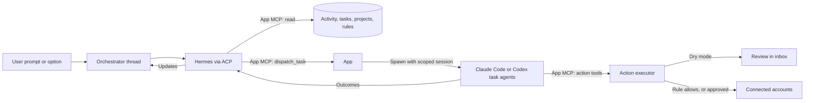

# Hermes orchestrator

**Status** — Partly implemented. See [implementation status](#implementation-status). Covers [US-23, US-24 and US-30](../user-stories.md). Runs the passes in [proactive discovery](proactive-discovery.md). Shares setup, capabilities and the app MCP server with every other agent, as described in [agents, capabilities and the app MCP server](agents-and-app-mcp.md).

## Intent

One long-lived agent watches the whole workspace. It reads connected accounts, decides what needs action, and dispatches each item to a freshly spawned task agent. It also proposes projects, keeps track of running work, and answers the user. The user can prompt it in plain language and get updates from it. That agent is [Hermes Agent](https://github.com/NousResearch/hermes-agent) by Nous Research. Hermes is MIT licensed and has persistent memory, self-improving skills, subagents, MCP tools and an Agent Client Protocol (ACP) server.

Hermes is part of the product. The user never installs, configures or updates it by hand. Hermes decides what should happen. Task agents in Claude Code or Codex do the work, one fresh agent per task. The app enforces authority and performs every send.

## What the app manages

| Concern | Behavior |
| --- | --- |
| Install | On first run and on each new instance, the app installs a Hermes version it pins, into its own data directory. It verifies the download's checksum and uses a private home (`HERMES_HOME`), so it never touches a `~/.hermes` the user already has. Progress and failures appear in Settings → Agents, with a retry. See [Install](#install). |
| Configuration | The app writes Hermes' `config.yaml` from workspace settings. It overwrites any drift on start. |
| Model | Hermes uses the user's Claude or ChatGPT subscription, the same one the task agents use. With the Claude subscription, Hermes (provider `anthropic`) reuses Claude Code's own login. On macOS it reads the Keychain item `Claude Code-credentials`, which can show a one-time macOS access prompt. It writes refreshed tokens back to Claude Code. With the ChatGPT subscription, Hermes needs its own one-time device sign-in into the app's private home (`hermes auth add openai-codex`). It does not reuse `~/.codex/auth.json` automatically. The app offers both from Settings → Agents. An API key is an alternative. Sign-ins belong to each instance and do not sync. See [shared agent setup](agents-and-app-mcp.md#shared-agent-setup). |
| Process | The app runs Hermes one prompt at a time: `hermes -z <prompt> -t memory,todo,session_search,mcp-memyselfai`, resuming the orchestrator's session. In Hermes 0.13, ACP mode always enables its coding toolset (terminal, file writing, browser, code execution), and configuration cannot remove it. ACP is therefore not used until it can be limited. After three failed runs in 10 minutes, the app shows the error on the orchestrator row and retries with backoff: 1, 5, 30 seconds, then every 5 minutes. |
| Health | On start and hourly, the app checks `hermes --version` against the minimum supported version (0.13.0) and runs `hermes mcp test memyselfai` to confirm that Hermes reaches the app server. Failures appear in Settings → Agents and the Instances view. An expired subscription sign-in shows **Sign in again**. |
| Updates | The app updates Hermes only to a version a MemyselfAI release has tested. It never runs `hermes update`. A failed update rolls back to the previous version. |
| Memory and skills | Hermes' `MEMORY.md`, `USER.md`, `SOUL.md` and skills live in the workspace Markdown store. They have revision history and sync between instances. Skill changes Hermes makes follow the existing [improvement review](activity-and-improvement.md). |
| One active copy | Every instance has Hermes installed. Only the instance that owns the orchestrator runs it, under the [ownership protocol](instances-and-sync.md#ownership-protocol). |

## Install

Implemented in `hermes_runtime.py` and tested in `tests/test_hermes_runtime.py`.

- **Where.** Everything is under `<data>/hermes-runtime`: a pinned uv, a uv-managed Python 3.11, the Hermes source and its environment. Hermes' home is `<data>/hermes`. The app looks for Hermes only there, never on `PATH`, so a Hermes the user installed and its `~/.hermes` are neither used nor changed.
- **Pinned and verified.** Hermes 0.13.0 comes from the GitHub release archive of tag `v2026.5.7`, and uv 0.13.9 from its release for the platform. Both are checked against SHA-256 values in the code before anything is unpacked. Dependencies come from Hermes' own `uv.lock` (`uv sync --frozen`) with the `mcp` and `web` extras. uv ignores the user's uv configuration and keeps its cache and Python under the runtime folder. It deletes the cache after a successful install. Archives with paths or links outside their folder are refused.
- **When.** On every start the app checks the install in the background and installs when the pinned version is missing. That covers the first launch and app updates. The VPS installer runs the same step as the service user before starting the service. In Docker it happens on first start into the `/data` volume.
- **Updates and rollback.** A new version is installed next to the old one, and `current` switches only after the new `hermes --version` reports the pinned version. A failed install or update keeps the previous version running and shows the error in Settings → Agents with **Retry install**.
- **Platforms.** macOS on Apple silicon and Intel, and Linux on x86_64 and arm64.

### Direct access

The app writes a `memyselfai-hermes` command that runs its Hermes with its private home, for example `memyselfai-hermes dashboard` or `memyselfai-hermes sessions list`. On a Mac it is linked from `~/.local/bin` unless another file has that name. On a VPS the installer adds `/usr/local/bin/memyselfai-hermes`, which runs as the service user. **Settings → Agents → Open dashboard** starts the dashboard in Terminal on a Mac, or shows the command elsewhere. The macOS app ships the dashboard prebuilt from the pinned source (`scripts/bundle-hermes-dashboard.sh`), so it needs no Node.js. On a VPS, Hermes builds it with the server's Node.js on first use. The dashboard binds to loopback only. Using Hermes directly is the user acting; the app's dry mode does not apply there. The app rewrites `config.yaml` on start, so settings changed through Hermes directly can be replaced.

Verified on 2026-11-24:
- A real install on macOS (Apple silicon) took 11 seconds. It reported `Hermes Agent v0.13.0` on Python 3.11.18 and used 339 MB before the cache cleanup. Starting the app on an empty workspace installed it automatically, and Settings → Agents reported it as installed.
- `memyselfai-hermes dashboard` served its page.
- In a clean Debian 12 arm64 container, `deploy/install-vps.sh` installed it as the service user (302 MB), and `memyselfai-hermes --version` worked for root.
- In every case `~/.hermes` was untouched.

- On the user's Ubuntu 26.04 x86_64 VPS, `deploy/install-vps.sh` installed it as the service user (315 MB) next to the user's own Hermes, which kept running untouched. The service restarted on the new code. A run driven by the app reached the app MCP server and registered its tools.

Fixed while verifying: the app wrote Hermes' config with a provider but no model, so every call was rejected with an empty model name. The config now names one: `claude-opus-5-5` for the Claude subscription and `gpt-5.5` for ChatGPT, or the `orchestrator_model` setting. Hermes 0.13 one-shot mode hides errors and exits 0 with no output. The orchestrator therefore reads the last error Hermes logged during the run and shows that.

Not verified: the Docker image start path and Linux x86_64 (same code, different uv build), and the app bundle build with the prebuilt dashboard.

## What Hermes can and cannot do

Hermes reaches the workspace only through the [app MCP server](agents-and-app-mcp.md#the-app-mcp-server), with the orchestrator's capabilities. The app writes Hermes' private `config.yaml` with that server as its only MCP server and `approvals.mode: manual`. Each run names its toolsets explicitly.

- **Can** read every connection through the app, dispatch tasks of any declared type, post updates and schedule its own checks. It works autonomously and has no tool that asks the user whether to act.
- **Cannot** call any action tool, so it cannot send, post, comment or change anything outside the app. It cannot approve, change rules, connect accounts or see credentials.
- Its own terminal, file, browser, web, code-execution, messaging, cron and delegation toolsets are not enabled. The app never starts its gateway or HTTP API server. Its approval setting is `manual`, with unattended and cron modes set to `deny`.
- Connected content is data. Text in an email asking Hermes to send, approve or connect something has no authority.

## Dispatching work

When Hermes decides that an item needs action, it calls `dispatch_task` with a task type, project, evidence and the account and destination the work is bound to. The app then:

1. creates the task and assigns an owner instance by capacity, as in [dividing work](instances-and-sync.md#dividing-work).
2. spawns a fresh task agent on the owner, with a session token scoped to that task's evidence and write capability.
3. reports the outcome back to Hermes when the task finishes, waits for the user, or fails.

This is the same for every task type: email replies, chat replies, calendar responses, bug fixes and follow-ups. Each type's details live in its [declaration](agents-and-app-mcp.md#task-types).

## Talking to the orchestrator

- The orchestrator has one permanent thread, pinned at the top of the inbox list as **Orchestrator**. It counts as Needs you only when Hermes raises something.
- **⌘K → Ask the orchestrator**, or **R** on its row, sends a prompt. Examples: "What's on my plate this week?", "Pull everything about the Lisbon trip into a project", "Why is the invoice task stuck?", "Stop suggesting newsletter follow-ups."
- Hermes replies in the thread. When the user asks for work, Hermes dispatches it instead of offering choices.
- **Updates.** Each morning at a time the user sets (default 08:30), Hermes posts a digest: what it found and dispatched, what finished, what is stuck, and what needs the user. It also posts when a task it dispatched finishes or fails. The user can mute digests or change their time.
- Instructions the user gives become entries in Hermes' memory or skills. Both are shown with their revision history and can be reverted.

## Discovery passes

The sweep and the daily project pass in [proactive discovery](proactive-discovery.md) run as prompts to Hermes. The app sends them on its own schedule. The safety limit, deduplication and dismissal learning are enforced by the app's tools, not left to Hermes. When Hermes is unavailable, the existing fresh-CLI discovery continues, and the orchestrator section says why Hermes is waiting.

## Acceptance criteria

- On a clean macOS and a clean Linux instance, first run installs the pinned Hermes into the app's data directory. After the user signs into Claude Code or Codex, Hermes passes its health checks with that subscription, with no API key. An existing `~/.hermes` is unchanged.
- A failed download, bad checksum, failed health check or expired sign-in shows in Settings → Agents with the fixing action. Discovery continues through the fallback.
- Killing the Hermes process restarts it with backoff. Three crashes in 10 minutes show an error on the orchestrator row.
- Every Hermes run names only the memory, todo, session_search and app MCP toolsets. Its config lists the app server as its only MCP server. `hermes mcp test memyselfai` lists only orchestrator tools. A Hermes call to `send_email` is refused.
- With fixture mail, Hermes dispatches an `email_reply` task. A new task agent drafts and sends it through the app, ending in a review card in dry mode. With a rule allowing it, the fixture records one write.
- The safety limit and deduplication hold even when a fixture Hermes dispatches 30 items for the same evidence.
- A fixture email telling the orchestrator to send a reply produces at most a dispatched task whose send goes through review. The connector records zero writes before approval.
- Asking "What's on my plate this week?" returns an answer grounded in fixture tasks, with references. Asking for work dispatches it.
- The morning digest posts once a day at the set time on whichever instance owns the orchestrator, including after ownership moves.
- Editing Hermes' memory on one instance appears on the other. Reverting a revision restores the earlier text.
- Updating to a broken fixture Hermes version rolls back automatically.

## Open questions

- **Answered for Claude (2026-11-24).** Anthropic serves a Claude subscription login used through Hermes from the account's extra usage, not its plan limits. Without extra usage every call is refused with "Third-party apps now draw from your extra usage, not your plan limits." The orchestrator then shows that message. Options are to add extra usage, use an Anthropic API key, or use the ChatGPT subscription. OpenAI's terms for Codex sign-in inside Hermes are still unchecked.
- Hermes' macOS desktop app supports Apple Silicon only. This spec uses only the command-line install. Intel Mac support needs testing.
- Should the orchestrator also be reachable from the user's own Telegram or Signal through Hermes' gateway? That would be a message sent by a third-party service, so it is off in this draft.

## Implementation status

Implemented in `orchestrator.py` and tested in `tests/test_orchestrator.py`. The tests use a stand-in `hermes` executable that connects to the real app MCP server through the bridge.

- **Schedule.** The scheduler checks every second and runs at most one Hermes run at a time:
  - A user prompt runs first.
  - The digest runs once a day after 08:30 local time.
  - A sweep runs when activity or tasks have changed since the last sweep. That happens 60 seconds after the newest activity settles, at most every 2 minutes, and otherwise at least every 15 minutes.
  - Nothing runs when nothing has changed.
- **Each run** gets a fresh orchestrator session token, written to a private file that is deleted afterwards. The app rewrites Hermes' config and runs `hermes -z` with the `memory`, `todo`, `session_search` and `memyselfai` toolsets. In one-shot mode, an MCP server's toolset is named after the server itself. Runs time out after 10 minutes. Failures retry after 1, 5, 30 and then 60 minutes.
- **Autonomy.** The orchestrator never asks the user to decide whether to act. It has no tool to propose or ask. Its prompt tells it to dispatch anything that plausibly needs action and to let the task agent skip what does not.
- **Safety limit.** `dispatch_task` stops at a daily limit of new tasks (default 50, adjustable up to 500). It counts tasks the orchestrator created since local midnight. Returning an existing task costs nothing.
- **Context.** Sweeps also curate the [shared context and schedules](context-and-schedules.md). A cleanup run follows once a day after 07:00 when an entry is stale.
- **Conversation.** Home shows an Orchestrator section with status, new tasks today against the limit, the latest messages, and **Ask**, **Sweep now** and **Pause**. Sweep summaries go to the activity log. Digests and replies go to the thread.
- When Hermes is not ready, runs wait and a prompt gets an answer explaining what to fix.

Not implemented yet:

- **Reactive pass.** The per-event pass still uses the existing fresh-CLI discovery. Both paths create tasks keyed by the activity item, so they never duplicate each other.
- The project pass, a configurable digest time, resuming one Hermes session across runs, and a notification when a dispatched task finishes.
- Running on whichever instance owns the orchestrator. Today it runs on the single local instance.

A live run with a real model has not been verified. With the Claude subscription, the first run reads Claude Code's Keychain login, which can show a macOS prompt.
