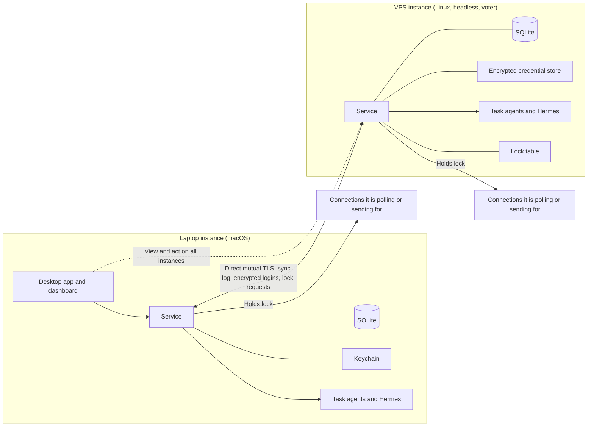

# Instances, sync and sharing work

**Status** — Draft, not implemented. Covers [US-25 through US-29](../user-stories.md). Changes the "one process owns a data directory" rule in the [desktop runtime](desktop-runtime.md). That rule still holds per instance, but several instances can now share one workspace.

## Intent

The user owns where the agent runs. The supported setups are:

| Setup | What runs where |
| --- | --- |
| **Laptop** | One instance on the Mac. This is today's app. |
| **VPS** | One headless instance on a Linux server the user controls. The user reaches its dashboard from the desktop app or through an SSH tunnel. |
| **Laptop and VPS** | Two or more paired instances sharing one workspace. They sync everything, including logins, and divide work by capacity. The VPS keeps discovering and working while the laptop sleeps. |

Instances talk to each other directly. Only instances the user has paired are trusted. No relay, broker or service run by the publisher sits between them. An organisation gateway that brokers connections for many users is out of scope. It is recorded under [future work](#future-work-organisation-gateway).

The one hard guarantee: **no instance works on a task, polls a connection or sends anything unless it holds that item's lock**. Locks are granted by the user's own instances, as described in [locks](#locks).

## Terms

- **Workspace** — the user's tasks, projects, rules, skills, style, activity, connections and logins. One workspace can span several instances.
- **Instance** — one running service with its own data directory, identity key, capacity and local resources.
- **Pairing** — mutual trust between two instances of the same workspace.
- **Lock** — a time-limited, exclusive claim on one task, one connection's polling, or one discovery pass. It carries a fencing token.
- **Voter** — an instance that grants locks. The user chooses the voters.

## Architecture

Each instance runs the same service. The macOS build adds the desktop window, Keychain and local-only sources. The Linux build is headless. It stores secrets in a file encrypted with a key from the OS credential service (systemd credentials) or, if that is unavailable, a passphrase entered at start. It runs under systemd or Docker. Each instance also runs its own managed [Hermes orchestrator](hermes-orchestrator.md), and only the lock holder's copy is active.

## Pairing

1. On the instance that already holds the workspace, the user chooses **Instances → Add instance**. The app shows a one-time pairing code, valid for ten minutes, and the command to install and start the other instance.
2. The user runs that command on the new machine and enters the code and the first instance's address. A laptop can pair with a VPS without being reachable itself, because the laptop always dials out.
3. Both instances show the other's name, platform and key fingerprint. The user confirms on the first instance.
4. Each instance stores the other's public key. All later traffic uses mutual TLS with those pinned keys. The code is never reused.
5. The first instance sends the workspace key to the new one over that channel. The workspace key encrypts logins in the sync log.

Instances sync only when one can reach the other directly. A laptop and a VPS always can. Two laptops can sync only on the same network or through an address one of them exposes, such as a VPN the user runs. The app never routes sync through a third party. When no peer is reachable, the Instances view says so.

A VPS dashboard listens on loopback only. The desktop app reaches it through the paired channel. A user without the desktop app uses `ssh -L`. The app never opens a public web port on its own.

**Instances → Remove** revokes the peer's key on every reachable instance and rotates the workspace key. A removed instance keeps the logins it already had, and the app cannot erase them remotely. So removal also shows each connection with a **Reconnect to revoke old login** action. That action signs in again through the provider and revokes the earlier grant where the provider allows it.

## What syncs

| Data | Synced | Notes |
| --- | --- | --- |
| Tasks, threads, options, decisions, questions, answers | Yes | Field-level versions, see [conflicts](#conflicts) |
| Projects, rules, skills, style, Markdown revisions, Hermes memory files | Yes | Same |
| Activity metadata and content | Yes | |
| Proposed actions, approvals, delivery records and receipts | Yes | |
| **Logins**: connector tokens, app passwords, refresh tokens | Yes, encrypted end to end with the workspace key | Each instance decrypts into its own Keychain or encrypted store. Logs never contain them. |
| AI CLI and model-provider sign-ins | No | Each instance signs into Claude Code, Codex or Hermes' model provider itself. These belong to the CLI, not the workspace. |
| Worktrees | On request, as a Git bundle | When a task moves between instances |
| Repository checkouts | No | Projects link repositories by origin URL. Each instance maps that URL to its own local path, if it has one. |

Sync is an append-only log of changes per instance, ordered by hybrid logical clocks. Instances exchange logs over the paired channel. Each instance applies changes it has not seen. Data rests in each instance's data directory. That directory should sit on an encrypted disk, and the VPS install guide says so.

## Locks

### Who grants them

Locks are granted by a **majority of voters**. The user picks the voters in Instances. Defaults:

| Instances | Default voters | Effect |
| --- | --- | --- |
| One | Itself | Works offline, as today |
| Laptop and VPS | The VPS alone | The laptop asks the VPS for every lock. The VPS is always on, so this rarely blocks. |
| Three or more | Every always-on instance, kept to an odd number | Survives the loss of a minority of voters |

A voter grants a lock only if it has not granted an unexpired lock on the same item to anyone else. A lock is valid when a majority of voters granted it. Voters persist grants before answering, so a restarted voter keeps its promises.

When an instance cannot reach a majority of voters, it does not take new locks. Work it already holds continues until its locks expire. Rows it would have started show "Waiting for VPS to lock this task". This is the price of the guarantee. If a voter is gone for good, the user can choose **Make this instance the voter** on a surviving instance. That step asks for typed confirmation and starts a new **epoch**. When an old voter returns, it sees the higher epoch and stops granting locks.

### Lock lifetime

- Every lock has a fencing token made of the epoch and a counter that only increases. Each new grant on the same item gets a higher token.
- A lock lasts 2 minutes. The holder renews it every 30 seconds. The holder measures time with its own monotonic clock and treats the lock as lost 20 seconds before expiry if it has not renewed.
- When a lock is lost, the holder stops the task's agent at once and records what it had produced as an interrupted attempt in the thread.
- A holder releases the lock when its run ends. The next run takes a fresh lock.

### What needs a lock

| Action | Lock | Extra check |
| --- | --- | --- |
| Starting or resuming a task agent, including a reply or option | The task's lock | None |
| Writing to the task's worktree or thread | The task's lock | The token travels with every synced change. Peers reject changes carrying a token older than the newest they have seen for that task. |
| Polling a connection or refreshing its token | The connection's lock | Refreshed tokens sync immediately. A provider that rotates refresh tokens is never refreshed by two instances at once. |
| Running a discovery pass or the active Hermes orchestrator | That pass's lock, or the orchestrator lock | None |
| **Dispatching an external write** | The task's lock | Before dispatch, the holder records a *send intent* with the action version and fencing token, and a majority of voters must accept it. Voters accept one send intent per action version. Then the holder dispatches. A second intent for the same version is refused, so the write happens at most once. |

Approvals can be made on any instance. An approval syncs to every instance. The instance that holds the task's lock, or takes it next, performs the dispatch. Sends happen as soon as the approval and lock allow. There is no delay window, consistent with the [inbox spec](inbox-experience.md).

## Conflicts

Locks remove conflicts over task work. Conflicts remain only for things a user edits by hand on two instances during a partition:

- Editable fields such as titles, rules, project membership and snooze time use last writer wins per field by hybrid logical clock. Ties break by instance ID.
- A task's state is derived from its event log, merged from every instance, never overwritten.
- Two answers to the same question from different instances: the earlier one by clock applies. The later one is kept and shown on the card as "also answered on VPS: …" so the user can reply again.
- Two approvals of the same action version are one approval. An approval of an older version never authorizes a newer one.
- Skills, style and Hermes memory Markdown keep both versions when edited on two instances during a partition. The card shows a merge question. Until it is answered, the earlier version stays active.

## Dividing work

Each instance advertises its capacity on every heartbeat, every 15 seconds:

- free and total agent slots. The default is 2 on a laptop and the CPU count minus one on a VPS. The user can change it.
- installed and signed-in CLIs
- repository origins it has checkouts for
- state: active, on battery, asleep or shutting down
- user preference: **Run here first**, **Overflow only** or **Never run agents**

A task is **eligible** on an instance when that instance has a signed-in CLI matching the workspace setting, any required checkout, and any desktop-only source the task needs. Among eligible instances, each instance computes the same preference:

1. the instance already holding the task's worktree,
2. **Run here first** instances over **Overflow only** ones,
3. an instance that is not on battery,
4. the most free slots,
5. the lowest instance ID, as a deterministic tie-break.

Only the preferred instance asks for the lock. If it has not taken the lock within 30 seconds, any eligible instance may ask. The lock still guarantees that only one runs. The preference only avoids wasted requests.

Connection polling follows the same idea. Always-on instances are preferred. Desktop-only sources, such as local folders, desktop chats and the frontmost app, are polled only by a macOS instance.

When a lock expires because its holder went offline, the next eligible instance takes it. A coding task whose worktree is on the lost instance waits up to 30 minutes for it to return. After that the task restarts from the project's base branch on another instance. The card says the earlier edits are on the offline instance.

A user can move a task with **Run on…** in the command palette. The source instance stops its agent, sends the worktree as a Git bundle over the paired channel, and then releases the lock. Nothing is pushed to a hosting provider.

## Instances view

**Instances** lists every paired instance with name, platform, state, voter role, last seen, slots in use, CLIs, connections it is polling and preference. It offers Add instance, Remove, Rename, voter choice and the preference. Each row in the inbox and board shows the instance where its agent last ran.

## Failures

| Situation | Behavior |
| --- | --- |
| Laptop asleep | The VPS keeps polling, running discovery and working tasks. Desktop-only sources pause and catch up on wake, as today. |
| VPS (sole voter) unreachable | The laptop finishes runs whose locks are still valid, then takes no new locks. Cards and Instances say why. The user can make the laptop the voter if the VPS is gone for good. |
| Partition with both online | Only the side with a voter majority takes locks. The other side stops at expiry. No task runs twice and no write is sent twice. |
| Lock holder freezes and resumes after expiry | Its next synced change or send intent carries an old fencing token and is refused. It sees the refusal and stops. |
| Clock skew over 30 seconds between peers | Sync is refused until it is fixed, and Instances shows the skew. Lock expiry uses each instance's monotonic clock, so skew never extends a lock. |
| Peer on a different app version | The sync protocol carries a version. Instances sync if both support the lower version. Otherwise Instances asks the user to update one of them. |
| Data directory restored from backup | The instance detects that its log is behind its own previous position at peers, takes a new instance ID and resyncs. A restored voter adopts the voters' latest epoch before granting. |

## Security boundaries

- Paired instances trust each other fully, including with logins, so pair only machines the user controls.
- Logins never leave the paired channel. They are encrypted with the workspace key in the sync log and at rest in each instance's secret store.
- Agents on every instance keep the [local agent](local-agent.md) sandbox: no connector credentials, no tool access to connected accounts, and no ability to approve. The same applies to [Hermes](hermes-orchestrator.md).
- The headless instance has no unauthenticated endpoint. Its loopback dashboard needs the same per-launch session as the desktop.

## Implementation phases

1. **Headless service on Linux.** Separate the service from AppKit, add the encrypted credential store, and ship an install script and Docker image. Setups *Laptop* and *VPS* work.
2. **Pairing, sync and the lock service.** Sync workspace state and logins. Every agent run, poll and send takes a lock, even with one instance. Add the Instances view.
3. **Capacity scheduling** and failover, then worktree bundles and **Run on…**.

Each phase ships with its acceptance criteria below passing.

## Acceptance criteria

- **Phase 1.** On a fresh Linux VM, the install command starts a headless instance under systemd. Its loopback dashboard opens through `ssh -L` with the session secret. Restarting the VM preserves tasks and connections. Credentials on disk are encrypted and never appear in logs.
- **Phase 2, pairing and sync.** Pairing with a valid code succeeds and shows matching fingerprints on both sides. An expired, reused or wrong code fails. A task created on the laptop appears on the VPS within 30 seconds, and the reverse. A connection made on the laptop polls from the VPS without signing in again there. Captured sync traffic contains no plaintext credential. Editing a title on both during a partition converges to the later edit on both. Removing an instance rotates the workspace key and offers reconnection for every connection.
- **Phase 2, locks.** With a fault-injecting test harness on two and three instances: under random partitions, pauses and restarts, no task agent ever runs on two instances at once, and every fixture write is dispatched at most once. A holder paused beyond expiry has its later changes and send intent refused. With the sole voter stopped, the other instance takes no new lock. **Make this instance the voter** raises the epoch, and the old voter stops granting when it returns. Two instances refreshing one rotating token never both refresh it.
- **Phase 3.** With the laptop's slots full, a new task runs on the VPS. With the preference *Overflow only* on the VPS and laptop slots free, it runs on the laptop. A task needing a desktop-only source never runs on the VPS. Killing the lock holder lets another instance take the task within 3 minutes. Moving a coding task transfers its worktree edits intact. Each discovery pass runs once per interval across two instances.

## Future work: organisation gateway

A gateway would hold OAuth app registrations for many users. It would give simpler sign-in but put a third party in the trust path. If built, it should be an optional component that only brokers sign-in and returns tokens to the user's own instances. It should never hold them itself. Not specified further.

## Open questions

- Is Docker acceptable as the primary VPS install, or should the first target be a single binary plus systemd unit?
- Default slots on a VPS: CPU count minus one assumes about 2 GB of memory per agent. Confirm with a measurement once phase 1 runs.
- Two instances with no always-on machine cannot both be voters without one blocking when the other sleeps. Is "one laptop is the voter" acceptable for that setup?
