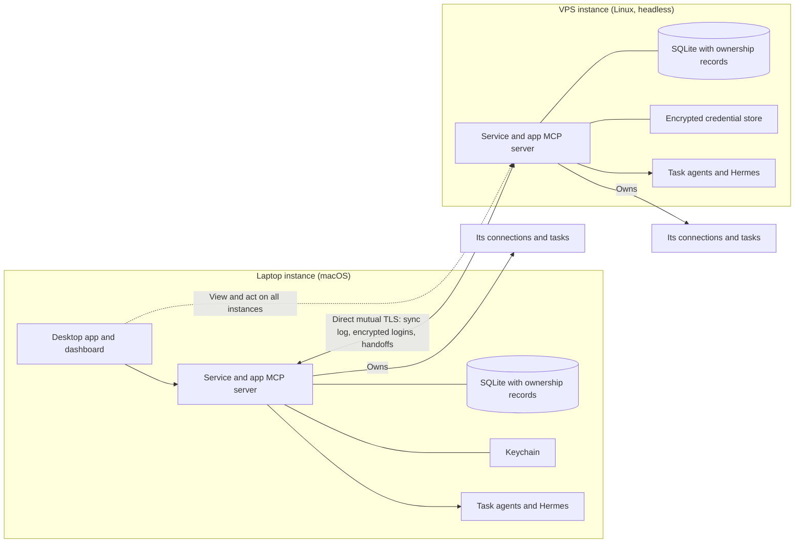

# Instances, sync and sharing work

**Status** — Draft. Phase 1 (headless Linux service) is implemented. See [phase 1 status](#phase-1-status) and the [VPS guide](../vps.md). Covers [US-25 through US-29](../user-stories.md). Changes the "one process owns a data directory" rule in the [desktop runtime](desktop-runtime.md). That rule still holds per instance, but several instances can now share one workspace.

## Intent

The user owns where the agent runs. The supported setups are:

| Setup | What runs where |
| --- | --- |
| **Laptop** | One instance on the Mac. This is today's app. |
| **VPS** | One headless instance on a Linux server the user controls. The user reaches its dashboard from the desktop app or through an SSH tunnel. |
| **Laptop and VPS** | Two or more paired instances sharing one workspace. They sync everything, including logins, and divide work by capacity. Each keeps working when the other is unreachable. |

Instances talk to each other directly. Only instances the user has paired are trusted. No relay, broker or service run by the publisher sits between them. An organisation gateway that brokers connections for many users is out of scope. It is recorded under [future work](#future-work-organisation-gateway).

The one hard guarantee: **every task, connection and the orchestrator has exactly one owner instance at a time, and only the owner may work on it, poll it or send for it.** Ownership changes only through the [ownership protocol](#ownership-protocol). No instance, including the VPS, is needed to grant it.

## Terms

- **Workspace** — the user's tasks, projects, rules, skills, style, activity, connections and logins. One workspace can span several instances.
- **Instance** — one running service with its own data directory, identity key, capacity and local resources.
- **Pairing** — mutual trust between two instances of the same workspace.
- **Item** — anything that must be worked on by one instance at a time: a task, a connection's polling and token refresh, or the orchestrator.
- **Owner** — the one instance allowed to act on an item.
- **Ownership epoch** — a counter per item that rises by one at every change of owner. It doubles as a fencing token.

## Architecture

Each instance runs the same service, including the [app MCP server](agents-and-app-mcp.md#the-app-mcp-server). The macOS build adds the desktop window, Keychain and local-only sources. The Linux build is headless. It stores secrets in a file encrypted with a key from the OS credential service (systemd credentials) or, if that is unavailable, a passphrase entered at start. It runs under systemd or Docker. Each instance has the managed [Hermes orchestrator](hermes-orchestrator.md) installed. Only the orchestrator's owner runs it.

## Pairing

1. On the instance that already holds the workspace, the user chooses **Instances → Add instance**. The app shows a one-time pairing code, valid for ten minutes, and the command to install and start the other instance.
2. The user runs that command on the new machine and enters the code and the first instance's address. A laptop can pair with a VPS without being reachable itself, because the laptop always dials out.
3. Both instances show the other's name, platform and key fingerprint. The user confirms on the first instance.
4. Each instance stores the other's public key. All later traffic uses mutual TLS with those pinned keys. The code is never reused.
5. The first instance sends the workspace key to the new one over that channel. The workspace key encrypts logins in the sync log.

Instances sync only when one can reach the other directly. A laptop and a VPS always can. Two laptops can sync only on the same network or through an address one of them exposes, such as a VPN the user runs. The app never routes sync through a third party. When no peer is reachable, the Instances view says so.

A VPS dashboard listens on loopback only. The desktop app reaches it through the paired channel. A user without the desktop app uses `ssh -L`. The app never opens a public web port on its own.

**Instances → Remove** revokes the peer's key on every reachable instance and rotates the workspace key. Items the removed instance owned need a [takeover](#takeover-when-an-owner-is-gone). A removed instance keeps the logins it already had, and the app cannot erase them remotely. So removal also shows each connection with a **Reconnect to revoke old login** action. That action signs in again through the provider and revokes the earlier grant where the provider allows it.

## What syncs

| Data | Synced | Notes |
| --- | --- | --- |
| Tasks, threads, options, decisions, questions, answers | Yes | Field-level versions, see [conflicts](#conflicts) |
| Ownership records and handoffs | Yes | Signed by the instance that wrote them |
| Projects, rules, skills, style, Markdown revisions, Hermes memory files | Yes | |
| Activity metadata and content | Yes | |
| Proposed actions, approvals, delivery records and receipts | Yes | |
| **Logins**: connector tokens, app passwords, refresh tokens | Yes, encrypted end to end with the workspace key | Each instance decrypts into its own Keychain or encrypted store. Logs never contain them. |
| AI subscription sign-ins for Claude Code, Codex and Hermes | No | Each instance signs in itself. See [shared agent setup](agents-and-app-mcp.md#shared-agent-setup). |
| Worktrees | With a handoff, as a Git bundle | |
| Repository checkouts | No | Projects link repositories by origin URL. Each instance maps that URL to its own local path, if it has one. |

Sync is an append-only log of changes per instance, ordered by hybrid logical clocks. Instances exchange logs over the paired channel. Each instance applies changes it has not seen. Data rests in each instance's data directory. That directory should sit on an encrypted disk, and the VPS install guide says so.

## Ownership protocol

Two instances can be cut off from each other at any time, and neither can tell whether the other is asleep or only unreachable. So no rule based on timeouts or majorities can let both keep working safely without a third machine. This protocol instead gives each item to one owner and lets ownership move only when the owner hands it over. Each instance keeps working on what it owns, with or without its peers.

### Rules

1. **Creation.** The instance that creates an item owns it at epoch 1. A task that comes from connected evidence is created only by the owner of that evidence's connection, deduplicated by evidence key. When the orchestrator calls `dispatch_task` on another instance, the call is forwarded to that connection's owner. If the owner is unreachable, the dispatch waits. A task the user types is created by the instance they typed it on. In every case, if another instance is better placed by capacity, the creator then hands the task over (rule 3).
2. **Acting.** An instance acts on an item only while its own records say it is the owner at the item's latest epoch. Acting means running an agent, writing to the task's thread or worktree, polling, refreshing a token or dispatching a write.
3. **Handoff.** Ownership moves only when the current owner hands it over:
   1. The receiver asks, or the owner offers.
   2. The owner stops acting. It waits for any running agent to stop and any send in progress to settle, then records the delivery state.
   3. The owner writes a signed handoff record: item, new epoch, new owner, and for a task the worktree bundle. It sends the record directly to the receiver.
   4. The receiver stores the record and confirms. Only then does it act.
   5. If the receiver does not confirm, the owner retries. The receiver ignores a duplicate handoff for an epoch it already holds. Until the receiver confirms, the owner does not act, so at most one side acts. If the handoff cannot complete within 10 minutes, the owner writes a cancellation for the same epoch, which the receiver must also accept before acting. Then the owner may act again.
4. **Fencing.** Every synced change to an item carries the writer's epoch. Peers reject changes from an older epoch. An instance that receives a record with a higher epoch than its own stops acting on that item at once.
5. **Sends.** Before an external write, the owner records a *send intent* with the action version and epoch in its own durable log. A send intent survives a crash. After a restart, the owner reconciles any intent without a receipt before it does anything else. A send intent and its outcome travel with every handoff. A new owner never sends an action version that already has an intent, unless reconciliation shows it was not delivered.

Because only the owner can create the next epoch, two instances can never both believe they own an item at the same epoch. This needs no shared clock, no quorum and no third instance.

### Planned absence

Most absences are known in advance. Before it sleeps, quits, shuts down or loses power on battery, an instance hands its items to a reachable peer that is eligible and has capacity. A macOS instance uses the system's will-sleep and will-power-off notifications, and a headless instance uses its service stop signal. Items no peer can take stay with their owner. Each item is handed over as described in rule 3. Running agents get up to 20 seconds to stop. An agent that cannot stop in time is stopped, and its partial work goes with the handoff as an interrupted attempt.

When the instance comes back, it can ask for items back under the normal capacity preferences.

### Takeover when an owner is gone

A crash, a dead disk or a lost laptop leaves items with an owner that cannot hand them over. Their rows show "Owned by Laptop, last seen 3 hours ago". The other instances never take them over on their own.

The user can choose **Take over from Laptop** in Instances, for all of its items or for a single row. The app warns that if that instance is still running somewhere, both may act on those items. It asks for typed confirmation. The takeover writes ownership at a higher epoch. When the old instance reconnects, it sees the higher epoch and stops. Its unsynced work is kept on the affected tasks as discarded attempts. Any send intent without a receipt is reconciled, through the connector's verification read, before the new owner sends that action.

This is the only path where duplicate work is possible, and only when the user takes over from an instance that is in fact still running. To narrow it, connectors that support it send with an identifier derived from the action version, such as an email Message-ID, and check for an earlier delivery before sending.

## Conflicts

Ownership removes conflicts over task work. Conflicts remain only for things a user edits by hand on two instances while they are cut off:

- Editable fields such as titles, rules, project membership and snooze time use last writer wins per field by hybrid logical clock. Ties break by instance ID.
- A task's state is derived from its event log, merged from every instance, never overwritten.
- Two answers to the same question from different instances: the earlier one by clock applies. The later one is kept and shown on the card as "also answered on VPS: …" so the user can reply again.
- Two approvals of the same action version are one approval. An approval of an older version never authorizes a newer one. An approval made on a non-owner syncs to the owner, which sends.
- Skills, style and Hermes memory Markdown keep both versions when edited on two instances while cut off. The card shows a merge question. Until it is answered, the earlier version stays active.
- Two instances cut off from each other may each discover the same item. Tasks are created from evidence only by the owner of the evidence's connection, so the same email never becomes two tasks.

## Dividing work

Each instance advertises its capacity on every heartbeat, every 15 seconds:

- free and total agent slots. The default is 2 on a laptop and the CPU count minus one on a VPS. The user can change it.
- readiness of Claude Code, Codex and Hermes
- repository origins it has checkouts for
- state: active, on battery, about to sleep, or shutting down
- user preference: **Run here first**, **Overflow only** or **Never run agents**

A task is **eligible** on an instance when that instance has a ready task harness, any required checkout, and any desktop-only source the task needs. When the owner of a new or queued task has no free slot or is not eligible, it chooses the best eligible peer and offers a handoff:

1. **Run here first** instances over **Overflow only** ones,
2. an instance that is not on battery,
3. the most free slots,
4. the lowest instance ID, as a deterministic tie-break.

If no peer is reachable, the task stays queued with its owner until a slot frees up or a peer appears. While idle with free slots, an instance may ask peers to hand over queued tasks it is eligible for.

Connections prefer an always-on owner. When a VPS is paired, the laptop offers it its connections, except desktop-only sources such as local folders, desktop chats and the frontmost app. Those are always owned by a macOS instance. A task needing a token for a connection its instance does not own uses the synced token. If that token has expired, it asks the connection's owner to refresh it. A rotating refresh token is refreshed only by its owner.

The orchestrator also prefers an always-on owner. With no VPS reachable, the laptop keeps its own orchestrator only if it already owns it. Otherwise discovery on the laptop falls back to the fresh-CLI passes, over the connections the laptop owns.

A user can move a task with **Run on…** in the command palette. This performs a handoff, including the worktree bundle. Nothing is pushed to a hosting provider.

## Instances view

**Instances** lists every paired instance with name, platform, state, last seen, slots in use, agent readiness, items owned and preference. It offers Add instance, Remove, Rename, the preference and **Take over**. Each row in the inbox and board shows its owner.

## Failures

| Situation | Behavior |
| --- | --- |
| Laptop sleeps | Before sleeping it hands its tasks and connections to the VPS. The VPS keeps polling, discovering and working. Desktop-only sources pause and catch up on wake, as today. |
| VPS unreachable | The laptop keeps working on everything it owns, including sending. Items the VPS owns wait for it. Their rows say so. New tasks created on the laptop run there. |
| Cut off with both online | Each instance continues on what it owns. No item is worked or sent by both. When they reconnect, proposals merge by evidence key and queued work rebalances. |
| Laptop crashes without handing over | Its items wait. The user can **Take over** after typed confirmation. |
| Instance pauses and resumes after a takeover | Its next synced change carries an old epoch and is refused. It learns of the higher epoch and stops. |
| Handoff interrupted | The owner still owns the item and does not act until the receiver confirms or the handoff is cancelled. No item is left with two owners or with none. |
| Clock skew between peers | Ownership does not depend on clocks. Large skew only affects the ordering of hand-edited fields. Instances shows skew over 30 seconds. |
| Peer on a different app version | The sync protocol carries a version. Instances sync if both support the lower version. Otherwise Instances asks the user to update one of them. |
| Data directory restored from backup | The instance detects that its log is behind its own previous position at peers. It takes a new instance ID, gives up every item it owned at an older epoch, and resyncs. |

## Security boundaries

- Paired instances trust each other fully, including with logins, so pair only machines the user controls.
- Logins never leave the paired channel. They are encrypted with the workspace key in the sync log and at rest in each instance's secret store.
- Handoff and ownership records are signed with the instance key. A peer cannot forge another instance's handoff.
- Agents on every instance reach the workspace only through the [app MCP server](agents-and-app-mcp.md), with capabilities limited to their task. They never see connector credentials.
- The headless instance has no unauthenticated endpoint. Its loopback dashboard needs the same per-launch session as the desktop.

## Implementation phases

1. **Headless service on Linux.** Separate the service from AppKit, add the encrypted credential store, and ship an install script and Docker image. Setups *Laptop* and *VPS* work.
2. **Pairing, sync and ownership.** Sync workspace state and logins. Every agent run, poll and send checks ownership, even with one instance. Add handoff, fencing, send intents and the Instances view.
3. **Capacity scheduling**, planned-absence handoffs, worktree bundles, **Run on…** and **Take over**.

Each phase ships with its acceptance criteria below passing.

## Acceptance criteria

- **Phase 1.** On a fresh Linux VM, the install command starts a headless instance under systemd. Its loopback dashboard opens through `ssh -L` with the session secret. Restarting the VM preserves tasks and connections. Credentials on disk are encrypted and never appear in logs.
- **Phase 2, pairing and sync.** Pairing with a valid code succeeds and shows matching fingerprints on both sides. An expired, reused or wrong code fails. A task created on the laptop appears on the VPS within 30 seconds, and the reverse. A connection made on the laptop polls from the VPS after a handoff, without signing in again there. Captured sync traffic contains no plaintext credential. Editing a title on both while cut off converges to the later edit on both. Removing an instance rotates the workspace key and offers reconnection for every connection.
- **Phase 2, ownership.** A fault-injecting harness runs two and three instances under random disconnections, pauses, crashes and restarts, including during handoffs. With no takeover, no item is ever acted on by two instances, every fixture write is dispatched at most once, and no item ends with no owner. With the VPS stopped, the laptop keeps running and sending for its own tasks. A crash between send intent and receipt leads to reconciliation, not a blind resend. A change carrying an old epoch is refused.
- **Phase 3.** With the laptop's slots full, a new task is handed to the VPS and runs there. With the preference *Overflow only* on the VPS and laptop slots free, it runs on the laptop. A task needing a desktop-only source never runs on the VPS. Putting the laptop to sleep hands its tasks and connections to the VPS, and a moved coding task keeps its worktree edits. A forced takeover after typed confirmation stops the old instance when it reconnects, and its unsent intents are reconciled before any resend.

## Phase 1 status

Implemented:

- **The same service runs headless on Linux.** Data lives in `$XDG_DATA_HOME/memyselfai` by default. `--port` fixes the port for SSH tunnels. `--launch-file` writes the one-time dashboard link to a file readable only by its owner. `SIGUSR1` issues a fresh link. `--bind` is meant for containers whose port is published on loopback.
- **Encrypted credential store** (`vault.py`). Where macOS Keychain is unavailable, connector credentials are sealed with AES-256-GCM. Each record is bound to its identity, so a ciphertext cannot be reused for another identity. The key comes from a systemd credential, a key file, or a `0600` file created in the data directory. The store needs the `cryptography` package.
- **Docker image and compose file.** The image runs as a non-root user, keeps everything persistent in one volume and publishes the port on loopback only. **A systemd installer** (`deploy/install-vps.sh`) adds a dedicated user, sandboxing directives and a host-bound encrypted credential when `systemd-creds` is available. `deploy/vps-open.sh` opens the tunnel and a fresh link.

Still open in phase 1:

- Verifying Google browser sign-in on a server.
- The systemd installer has been syntax-checked and run in a container without systemd. It has not been run on a real systemd host.

## Future work: organisation gateway

A gateway would hold OAuth app registrations for many users. It would give simpler sign-in but put a third party in the trust path. If built, it should be an optional component that only brokers sign-in and returns tokens to the user's own instances. It should never hold them itself. Not specified further.

## Open questions

- Is Docker acceptable as the primary VPS install, or should the first target be a single binary plus systemd unit?
- Default slots on a VPS: CPU count minus one assumes about 2 GB of memory per agent. Confirm with a measurement once phase 1 runs.
- Should a takeover ever happen automatically, for example after the owner has been silent for several days? This draft says never, because it cannot be made safe.
