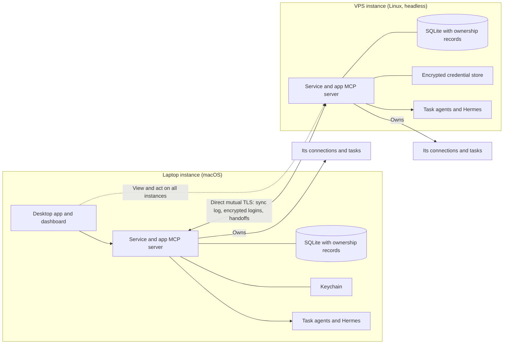

# Instances, sync and sharing work

**Status** — Draft. Phase 1 (headless Linux service), phase 2 (pairing, sync and ownership) and phase 3 (capacity scheduling, planned absence, **Run on…**, worktree handoff and automatic takeover) are implemented as described in [phase 2 design](#phase-2-design) and [phase 3 design](#phase-3-design). See the status sections and the [VPS guide](../vps.md). Covers [US-25 through US-29](../user-stories.md). Changes the "one process owns a data directory" rule in the [desktop runtime](desktop-runtime.md). That rule still holds per instance, but several instances can now share one workspace.

## Intent

The user owns where the agent runs. The supported setups are:

| Setup | What runs where |
| --- | --- |
| **Laptop** | One instance on the Mac. This is today's app. |
| **VPS** | One headless instance on a Linux server the user controls. The user reaches its dashboard from the desktop app or through an SSH tunnel. |
| **Laptop and VPS** | Two or more paired instances sharing one workspace. They sync everything, including logins, and divide work by capacity. Each keeps working when the other is unreachable. |

Instances talk to each other directly. Only instances the user has paired are trusted. No relay, broker or service run by the publisher sits between them. An organisation gateway that brokers connections for many users is out of scope. It is recorded under [future work](#future-work-organisation-gateway).

The one hard guarantee: **every task, connection and the orchestrator has exactly one owner instance at a time, and only the owner may work on it, poll it or send for it.** Ownership changes only through the [ownership protocol](#ownership-protocol). No instance, including the VPS, is needed to grant it.

## Terms

- **Workspace** — the user's tasks, projects, rules, skills, style, activity, connections and logins. One workspace can span several instances.
- **Instance** — one running service with its own data directory, identity key, capacity and local resources.
- **Pairing** — mutual trust between two instances of the same workspace.
- **Item** — anything that must be worked on by one instance at a time: a task, a connection's polling and token refresh, or the orchestrator.
- **Owner** — the one instance allowed to act on an item.
- **Ownership epoch** — a counter per item that rises by one at every change of owner. It doubles as a fencing token.

## Architecture

Each instance runs the same service, including the [app MCP server](agents-and-app-mcp.md#the-app-mcp-server). The macOS build adds the desktop window, Keychain and local-only sources. The Linux build is headless. It stores secrets in a file encrypted with a key from the OS credential service (systemd credentials) or, if that is unavailable, a passphrase entered at start. It runs under systemd or Docker. Each instance has the managed [Hermes orchestrator](hermes-orchestrator.md) installed. Only the orchestrator's owner runs it.

## Pairing

1. On the instance that already holds the workspace, the user chooses **Instances → Add instance**. The app shows a one-time pairing code, valid for ten minutes, and the command to install and start the other instance.
2. The user runs that command on the new machine and enters the code and the first instance's address. A laptop can pair with a VPS without being reachable itself, because the laptop always dials out.
3. Both instances show the other's name, platform and key fingerprint for reference. A valid code is the user's confirmation, so neither side asks again.
4. Each instance stores the other's public key. All later traffic uses mutual TLS with those pinned keys. The code is never reused.
5. The first instance sends the workspace key to the new one over that channel. The workspace key encrypts logins in the sync log.

Instances sync only when one can reach the other directly. A laptop and a VPS always can. Two laptops can sync only on the same network or through an address one of them exposes, such as a VPN the user runs. The app never routes sync through a third party. When no peer is reachable, the Instances view says so.

A VPS dashboard listens on loopback only. The desktop app reaches it through the paired channel. A user without the desktop app uses `ssh -L`. The app never opens a public web port on its own.

**Instances → Remove** revokes the peer's key on every reachable instance and rotates the workspace key. Items the removed instance owned need a [takeover](#takeover-when-an-owner-is-gone). A removed instance keeps the logins it already had, and the app cannot erase them remotely. So removal also shows each connection with a **Reconnect to revoke old login** action. That action signs in again through the provider and revokes the earlier grant where the provider allows it.

## What syncs

| Data | Synced | Notes |
| --- | --- | --- |
| Tasks, threads, options, decisions, questions, answers | Yes | Field-level versions, see [conflicts](#conflicts) |
| Ownership records and handoffs | Yes | Signed by the instance that wrote them |
| Projects, rules, skills, style, Markdown revisions, Hermes memory files | Yes | |
| Activity metadata and content | Yes | |
| Proposed actions, approvals, delivery records and receipts | Yes | |
| **Logins**: connector tokens, app passwords, refresh tokens | Yes, encrypted end to end with the workspace key | Each instance decrypts into its own Keychain or encrypted store. Logs never contain them. |
| AI subscription sign-ins for Claude Code, Codex and Hermes | No | Each instance signs in itself. See [shared agent setup](agents-and-app-mcp.md#shared-agent-setup). |
| Worktrees | With a handoff, as a Git bundle | |
| Repository checkouts | No | Projects link repositories by origin URL. Each instance maps that URL to its own local path, if it has one. |

Sync is an append-only log of changes per instance, ordered by hybrid logical clocks. Instances exchange logs over the paired channel. Each instance applies changes it has not seen. Data rests in each instance's data directory. That directory should sit on an encrypted disk, and the VPS install guide says so.

## Ownership protocol

Two instances can be cut off from each other at any time, and neither can tell whether the other is asleep or only unreachable. So no rule based on timeouts or majorities can let both keep working safely without a third machine. This protocol instead gives each item to one owner and lets ownership move only when the owner hands it over. Each instance keeps working on what it owns, with or without its peers.

### Rules

1. **Creation.** The instance that creates an item owns it at epoch 1. A task that comes from connected evidence is created only by the owner of that evidence's connection, deduplicated by evidence key. When the orchestrator calls `dispatch_task` on another instance, the call is forwarded to that connection's owner. If the owner is unreachable, the dispatch waits. A task the user types is created by the instance they typed it on. In every case, if another instance is better placed by capacity, the creator then hands the task over (rule 3).
2. **Acting.** An instance acts on an item only while its own records say it is the owner at the item's latest epoch. Acting means running an agent, writing to the task's thread or worktree, polling, refreshing a token or dispatching a write.
3. **Handoff.** Ownership moves only when the current owner hands it over:
   1. The receiver asks, or the owner offers.
   2. The owner stops acting. It waits for any running agent to stop and any send in progress to settle, then records the delivery state.
   3. The owner writes a signed handoff record: item, new epoch, new owner, and for a task the worktree bundle. It sends the record directly to the receiver.
   4. The receiver stores the record and confirms. Only then does it act.
   5. If the receiver does not confirm, the owner retries. The receiver ignores a duplicate handoff for an epoch it already holds. Until the receiver confirms, the owner does not act, so at most one side acts. If the handoff cannot complete within 10 minutes, the owner writes a cancellation for the same epoch, which the receiver must also accept before acting. Then the owner may act again.
4. **Fencing.** Every synced change to an item carries the writer's epoch. Peers reject changes from an older epoch. An instance that receives a record with a higher epoch than its own stops acting on that item at once.
5. **Sends.** Before an external write, the owner records a *send intent* with the action version and epoch in its own durable log. A send intent survives a crash. After a restart, the owner reconciles any intent without a receipt before it does anything else. A send intent and its outcome travel with every handoff. A new owner never sends an action version that already has an intent, unless reconciliation shows it was not delivered.

Because only the owner can create the next epoch, two instances can never both believe they own an item at the same epoch. This needs no shared clock, no quorum and no third instance.

### Planned absence

Most absences are known in advance. Before it sleeps, quits, shuts down or loses power on battery, an instance hands its items to a reachable peer that is eligible and has capacity. A macOS instance uses the system's will-sleep and will-power-off notifications, and a headless instance uses its service stop signal. Items no peer can take stay with their owner. Each item is handed over as described in rule 3. Running agents get up to 20 seconds to stop. An agent that cannot stop in time is stopped, and its partial work goes with the handoff as an interrupted attempt.

When the instance comes back, it can ask for items back under the normal capacity preferences.

### Takeover when an owner is gone

A crash, a dead disk, a lost laptop or a laptop that slept without handing over leaves items with an owner that cannot hand them over. The other instances take them over automatically: after 15 minutes of silence, or at once when the owner is removed. The user is not asked. See [automatic takeover](#phase-3-design) for the rules. When the old instance reconnects, it sees the higher epoch and stops. Its unsynced work is kept on the affected tasks as discarded attempts.

This is the only path where duplicate work is possible. It happens only when the silent instance was in fact still running and cut off from its peers while it could still reach the outside world. Sends are protected separately: a task that was being sent becomes `uncertain`. A taken-over task's pending version also needs the user's approval, even where rules would send it on their own, because sending is an external write.

## Conflicts

Ownership removes conflicts over task work. Conflicts remain only for things a user edits by hand on two instances while they are cut off:

- Editable fields such as titles, rules, project membership and snooze time use last writer wins per field by hybrid logical clock. Ties break by instance ID.
- A task's state is derived from its event log, merged from every instance, never overwritten.
- Two answers to the same question from different instances: the earlier one by clock applies. The later one is kept and shown on the card as "also answered on VPS: …" so the user can reply again.
- Two approvals of the same action version are one approval. An approval of an older version never authorizes a newer one. An approval made on a non-owner syncs to the owner, which sends.
- Skills, style and Hermes memory Markdown keep both versions when edited on two instances while cut off. The card shows a merge question. Until it is answered, the earlier version stays active.
- Two instances cut off from each other may each discover the same item. Tasks are created from evidence only by the owner of the evidence's connection, so the same email never becomes two tasks.

## Dividing work

Each instance advertises its capacity on every heartbeat, every 15 seconds:

- free and total agent slots. The default is 2 on a laptop and the CPU count minus one on a VPS. The user can change it.
- readiness of Claude Code, Codex and Hermes
- repository origins it has checkouts for
- state: active, on battery, about to sleep, or shutting down
- user preference: **Run here first**, **Overflow only** or **Never run agents**

A task is **eligible** on an instance when that instance has a ready task harness, any required checkout, and any desktop-only source the task needs. When the owner of a new or queued task has no free slot or is not eligible, it chooses the best eligible peer and offers a handoff:

1. **Run here first** instances over **Overflow only** ones,
2. an instance that is not on battery,
3. the most free slots,
4. the lowest instance ID, as a deterministic tie-break.

If no peer is reachable, the task stays queued with its owner until a slot frees up or a peer appears. While idle with free slots, an instance may ask peers to hand over queued tasks it is eligible for.

Connections prefer an always-on owner. When a VPS is paired, the laptop offers it its connections, except desktop-only sources such as local folders, desktop chats and the frontmost app. Those are always owned by a macOS instance. A task needing a token for a connection its instance does not own uses the synced token. If that token has expired, it asks the connection's owner to refresh it. A rotating refresh token is refreshed only by its owner.

The orchestrator also prefers an always-on owner. With no VPS reachable, the laptop keeps its own orchestrator only if it already owns it. Otherwise discovery on the laptop falls back to the fresh-CLI passes, over the connections the laptop owns.

A user can move a task with **Run on…** in the command palette. This performs a handoff, including the worktree bundle. Nothing is pushed to a hosting provider.

## Instances view

**Instances** lists every paired instance with name, platform, state, last seen, slots in use, agent readiness, items owned and preference. It offers Add instance, Join, Add checkout, Rename, Remove and the preference. Takeover is automatic. Each row in the inbox and board shows its owner.

## Failures

| Situation | Behavior |
| --- | --- |
| Laptop sleeps | Before sleeping it hands its tasks and connections to the VPS. The VPS keeps polling, discovering and working. Desktop-only sources pause and catch up on wake, as today. |
| VPS unreachable | The laptop keeps working on everything it owns, including sending. Items the VPS owns wait for it. Their rows say so. New tasks created on the laptop run there. |
| Cut off with both online | Each instance continues on what it owns. No item is worked or sent by both. When they reconnect, proposals merge by evidence key and queued work rebalances. |
| Laptop crashes without handing over | After 15 minutes of silence, the VPS takes over its tasks and connections automatically. |
| Instance pauses and resumes after a takeover | Its next synced change carries an old epoch and is refused. It learns of the higher epoch and stops. |
| Handoff interrupted | The owner still owns the item and does not act until the receiver confirms or the handoff is cancelled. No item is left with two owners or with none. |
| Clock skew between peers | Ownership does not depend on clocks. Large skew only affects the ordering of hand-edited fields. Instances shows skew over 30 seconds. |
| Peer on a different app version | The sync protocol carries a version. Instances sync if both support the lower version. Otherwise Instances asks the user to update one of them. |
| Data directory restored from backup | The instance detects that its log is behind its own previous position at peers. It takes a new instance ID, gives up every item it owned at an older epoch, and resyncs. |

## Security boundaries

- Paired instances trust each other fully, including with logins, so pair only machines the user controls.
- Logins never leave the paired channel. They are encrypted with the workspace key in the sync log and at rest in each instance's secret store.
- Handoff and ownership records are signed with the instance key. A peer cannot forge another instance's handoff.
- Agents on every instance reach the workspace only through the [app MCP server](agents-and-app-mcp.md), with capabilities limited to their task. They never see connector credentials.
- The headless instance has no unauthenticated endpoint. Its loopback dashboard needs the same per-launch session as the desktop.

## Implementation phases

1. **Headless service on Linux.** Separate the service from AppKit, add the encrypted credential store, and ship an install script and Docker image. Setups *Laptop* and *VPS* work.
2. **Pairing, sync and ownership.** Sync workspace state and logins. Every agent run, poll and send checks ownership, even with one instance. Add handoff, fencing, send intents and the Instances view.
3. **Capacity scheduling**, planned-absence handoffs, worktree bundles, **Run on…** and automatic takeover.

Each phase ships with its acceptance criteria below passing.

## Acceptance criteria

- **Phase 1.** On a fresh Linux VM, the install command starts a headless instance under systemd. Its loopback dashboard opens through `ssh -L` with the session secret. Restarting the VM preserves tasks and connections. Credentials on disk are encrypted and never appear in logs.
- **Phase 2, pairing and sync.** Pairing with a valid code succeeds and shows matching fingerprints on both sides. An expired, reused or wrong code fails. A task created on the laptop appears on the VPS within 30 seconds, and the reverse. A connection made on the laptop polls from the VPS after a handoff, without signing in again there. Captured sync traffic contains no plaintext credential. Editing a title on both while cut off converges to the later edit on both. Removing an instance rotates the workspace key and offers reconnection for every connection.
- **Phase 2, ownership.** A fault-injecting harness runs two and three instances under random disconnections, pauses, crashes and restarts, including during handoffs. With no takeover, no item is ever acted on by two instances, every fixture write is dispatched at most once, and no item ends with no owner. With the VPS stopped, the laptop keeps running and sending for its own tasks. A crash between send intent and receipt leads to reconciliation, not a blind resend. A change carrying an old epoch is refused.
- **Phase 3.** With the laptop's slots full, a new task is handed to the VPS and runs there. With the preference *Overflow only* on the VPS and laptop slots free, it runs on the laptop. A task needing a desktop-only source never runs on the VPS. Putting the laptop to sleep hands its tasks and connections to the VPS, and a moved coding task keeps its worktree edits. A forced takeover after typed confirmation stops the old instance when it reconnects, and its unsent intents are reconciled before any resend.

## Phase 1 status

Implemented:

- **The same service runs headless on Linux.** Data lives in `$XDG_DATA_HOME/memyselfai` by default. `--port` fixes the port for SSH tunnels. `--launch-file` writes the one-time dashboard link to a file readable only by its owner. `SIGUSR1` issues a fresh link. `--bind` is meant for containers whose port is published on loopback.
- **Encrypted credential store** (`vault.py`). Where macOS Keychain is unavailable, connector credentials are sealed with AES-256-GCM. Each record is bound to its identity, so a ciphertext cannot be reused for another identity. The key comes from a systemd credential, a key file, or a `0600` file created in the data directory. The store needs the `cryptography` package.
- **Docker image and compose file.** The image runs as a non-root user, keeps everything persistent in one volume and publishes the port on loopback only. **A systemd installer** (`deploy/install-vps.sh`) adds a dedicated user, sandboxing directives and a host-bound encrypted credential when `systemd-creds` is available. `deploy/vps-open.sh` opens the tunnel and a fresh link.

Still open in phase 1:

- Verifying Google browser sign-in on a server.
- The systemd installer has been syntax-checked and run in a container without systemd. It has not been run on a real systemd host.

## Phase 2 design

This section fixes the details phase 2 implements. Where it narrows the sections above, it wins until phase 3.

**Transport.** An instance that should be reachable starts a sync listener with `--sync-port` (default off). The listener is plain HTTPS with mutual TLS. Each instance has a self-signed P-256 certificate created with `openssl` at first start. Its SHA-256 fingerprint is its identity. The listener trusts only the certificates of paired peers. Everything except the pairing request needs a client certificate from a trusted peer. A laptop has no listener and dials out. One exchange carries changes both ways, so a peer that cannot dial back still receives everything. Instances exchange every 5 seconds and right after a local change.

**Pairing.**

1. **Add instance** on the reachable instance, usually the VPS, shows a code: 120 random bits, valid for 10 minutes, one at a time.
2. **Join** on the other instance takes the address and the code. It connects, reads the listener's certificate, and sends its own certificate with an HMAC of both fingerprints keyed by the code. The listener checks the proof and answers with a proof of its own. The code is then spent. A man in the middle would have to know the code. Five wrong proofs spend the code too.
3. Both sides trust each other at once, because the code proves both ends. Both show both fingerprints. **Remove** undoes a pairing at any time.
4. The workspace key is sent on the first exchange. Whichever side has the newer key version gives it to the other.

Data on both sides merges. The joiner does not need to be empty.

**The change log.** Once an instance has a peer, every write to synced data also appends a change to its log: origin instance, origin sequence, hybrid logical clock, record, field, value and ownership epoch. Instances exchange log entries by their local sequence. They store and relay entries from third instances, so three instances converge through any connected path. Applying a change is idempotent by origin and sequence. Fields merge by last writer wins on the clock, with ties broken by instance ID. A task's state is a field like any other, so it is not merged from an event log. Ownership makes that safe, because only the owner moves a task's state forward. Activity entries are appended, never merged. When an instance first gains a peer, it writes all its current records to the log as a baseline.

Not synced: the instance's own identity and peers, and the per-instance settings for the AI CLI and the orchestrator's subscription.

**Logins.** Secrets in the app's own credential store, the macOS Keychain or the encrypted file store, travel as `@secret` changes. Each is sealed with the workspace key: an HMAC-SHA256 keystream with a separate HMAC-SHA256 tag over identity, nonce and ciphertext. This uses only the standard library, because the Mac service has no `cryptography` package. The receiver unseals it into its own store. Logins held by other tools do not sync: `gh` sign-ins, Google sign-ins through a browser profile, and AI subscriptions. A connection that relies on one of them polls only from an instance where that login exists. Google browser-profile connections are always desktop-only.

**Ownership records.** The `owners` records hold `{item, owner, epoch}` for `task:<id>`, `connection:<id>` and `orchestrator`. Creating a task or connection writes its owner record before the row, so a peer never sees the row without it. At start, an instance claims any item that has no record and the orchestrator if nobody owns it. Owner records merge by the higher epoch, not by clock. Two records with the same epoch and different owners can arise only when two workspaces that each held the item are paired. The lower instance ID then wins on both sides, and the event is logged.

**Handoff through the log.** Phase 2 makes handoffs records in the synced log, so they work across the one-way dialing path:

1. The owner writes an offer `{item, epoch: current+1, from, to}` and from then on does not act on the item. It offers only an idle item: no agent running and no send in flight.
2. The receiver sees the offer. If its owner record is at `epoch-1` and the offer is not cancelled, it writes the owner record `{owner: itself, epoch}` and answers `confirmed`. Only then does it act.
3. If 10 minutes pass with no answer, the owner marks the offer cancelled. The receiver answers `cancel_ack` only if it has not already confirmed. The owner acts again only after it sees `cancel_ack`. If it sees the receiver's higher owner record instead, the handoff happened.

An offer is pending until it is answered `cancel_ack` or the receiver's owner record arrives. While it is pending, neither side acts.

**Fencing.** A change to a task or connection carries the writer's view of the owner epoch. A peer refuses changes with an older epoch than its own record and logs "Refused change from an older owner".

**Checks in the engine.** The scheduler runs agents, polls connections, discovers events and sends only for items this instance owns. It also checks ownership again before saving an agent's result. Events are processed by the owner of their connection. An approval pressed on an instance that does not own the task is recorded for that exact version and synced. The owner then sends that version. When the orchestrator dispatches evidence from a connection another instance owns, it records a dispatch request. The connection's owner creates the task. Before a send, the owner records a send intent on the task: version, epoch and instance. A send that was in progress during a crash becomes `uncertain` at restart, as before. It is reconciled, never resent blindly.

**Instances view.** Settings → Instances shows this instance's name and fingerprint, then each peer: platform, last exchange, slots, agent readiness and the items it owns. It offers **Add instance** (code), **Join** and **Remove**. Phase 2 first had **Confirm**, **Reject** and hand-over buttons. Phase 3 removed them: pairing, connection placement and takeover are automatic. Removing a peer revokes it on every reachable instance, rotates the workspace key, re-seals every login and flags each connection with **Reconnect to revoke old login**.

**Left to phase 3:** capacity-based handoffs, planned absence, worktree bundles, **Run on…** and **Take over**. Phase 2 also does not sign handoff records with the instance key. Paired instances trust each other fully, and records arrive only over mutual TLS from a paired peer. A refresh token rotated by a non-owner during a send is a known risk until owners refresh on request.

## Phase 3 design

This section fixes how phase 3 splits work and hands it over before an absence. Where it narrows the sections above, it wins.

**Capacity on every exchange.** Each exchange carries the sender's capacity: slots, free slots, preference, state (`active`, `sleeping` or `stopping`), whether it runs on battery, whether its task CLI is ready, and whether Hermes is ready. A peer's capacity counts as fresh for 60 seconds after its last exchange. Slots and preference are per-instance settings in Settings → Agent settings, and they do not sync. The default is 2 slots on a Mac and the CPU count minus one elsewhere. An instance now runs at most its slot count of tasks at once. Before phase 3, up to 6 ran at once.

**Pinned tasks.** Some tasks stay with their owner, for scheduling and for absences alike:

- tasks with local evidence, such as a folder or a desktop chat,
- tasks from a Google browser-profile connection,
- app self-checks and app findings,
- coding and bug tasks whose repository is not chosen yet.

A task with a repository can move only to an instance with a checkout of the same origin. See [worktree handoff](#phase-3-design) below. The user can still move a pinned task with **Run on…**.

**Scheduling, run by each owner about every 5 seconds.** For each queued task it owns, unpinned, due, and not offered in the last 60 seconds:

1. It keeps the task if it is eligible (preference not *Never run agents*, task CLI ready) and has a free slot. The exception is an *Overflow only* instance: it offers the task when a fresh *Run here first* peer is eligible and has a free slot.
2. Otherwise it offers the task to the best fresh eligible peer with a free slot. Peers rank *Run here first* before *Overflow only*, then not on battery, then most free slots, then lowest instance ID.
3. Otherwise the task stays queued.

**Pulling.** An instance that is eligible, active and has free slots after its own work asks for queued, unpinned tasks owned by a fresh peer that has no free slot or is not eligible. It asks at most once per task every 60 seconds. The request goes through the log, and the owner offers the task only while it is idle.

**Planned absence.** The service prepares for an absence on these triggers:

- **Sleep on a Mac.** The desktop host registers for system power notifications. On "will sleep" it sends the service `SIGUSR2` and holds the sleep for up to 25 seconds, or until the service signals back with `SIGUSR1`.
- **Quit or stop.** `SIGTERM` comes from quitting the Mac app, `systemctl stop` or `docker stop`. The service prepares, then exits. Systemd waits up to 60 seconds and Docker up to 30.

While preparing, the instance reports `sleeping` or `stopping`, starts no new task, and pulls nothing. For up to 20 seconds, it waits for running agents and sends to finish. It hands each idle item to the best fresh peer:

- unpinned tasks that are not closed, including tasks awaiting approval or an answer, so the user can still act from the other instance,
- connections the peer can poll: not browser-profile Google, not `gh` sign-ins,
- the orchestrator, if the peer's Hermes is ready.

It exchanges every 0.3 seconds until every offer is confirmed or time is up. An offer still unanswered at the deadline stays pending, and the normal 10-minute cancellation applies. Work still running at the deadline stays with its owner and is requeued at restart, as before. After waking, the instance resumes normally. It wins back tasks only through pulling, and connections stay with the peer until the user takes them back.

**Run on….** The task detail offers **Run on <instance>** for each paired instance. It records a move request for that task.

**Worktree handoff.** A coding task can move once it has a repository, to an instance that has a checkout of the same origin.

- **Checkouts by origin.** Repository paths in projects belong to the instance that registered them. Each instance advertises the normalised origin URLs of its checkouts, such as `github.com/owner/repo`. Those are the project repositories that exist on that machine, plus checkouts added under Settings → Instances → **Add checkout**, which stay local.
- **Bundle at offer.** When the owner offers a task with a worktree, it snapshots the worktree, including uncommitted and untracked files, into a commit made with a temporary index. The user's index and files are untouched. It writes a Git bundle of the task branch and the snapshot, relative to the branch's merge base with the clone's remote-tracking branches or, for a private task clone without them, the commit the clone started from. When that base is the branch tip, the bundle starts one commit earlier so the branch ref is included. The bundle rides with the offer as a synced `bundles` record. A bundle over 4 MB cannot be sent, so the task stays.
- **Import before confirming.** The receiver creates its own private task clone (`clones/task-<id>`, see [task execution](task-execution.md)) from its checkout of that origin, and fetches the checkout's branches into the clone for history. It verifies the bundle in the clone, fetching `origin` into the checkout once if the base commit is missing. It moves the clone's branch `memyselfai/task-<id>` to the handed-over commit and restores the snapshot as uncommitted changes. Nothing is written to the user's checkout. Only then does it confirm. If the import fails, it answers `declined` with the reason, and the owner resumes at once. The sender keeps its own worktree.
- **Clone when missing.** An instance with Git advertises that it can clone. A receiver without a checkout clones the task's origin, using its own Git credentials, into `checkouts/` in its data directory, then imports. Cloning reads the repository and writes nothing to it, so the user is not asked. If the clone fails, the receiver declines. The owner then does not offer that task to that instance again for an hour. **Add checkout** stays available to reuse an existing clone.
- **Coding tasks without a repository yet** stay with their owner, because the repository is chosen from that instance's checkouts.

**Only writes and sends involve the user.** Coordination between instances never asks the user anything: pairing after the code, handoffs, connection placement, takeover and cloning. The user approves only what writes to a repository or sends something, such as mail, messages or calendar events, under the existing dry-mode and rules flow.

**Connections and the orchestrator prefer an always-on instance.** A Mac instance that sees an active non-Mac peer offers it each connection that peer can poll, about once a minute while idle. It also offers the orchestrator if the peer's Hermes is ready. If that peer stops and hands them back, they return once it is active again. There are no hand-over buttons.

**Automatic takeover.** Every few seconds, each instance checks for peers that have been silent for 15 minutes, and for removed peers that still own items.

1. Only the best-ranked live instance takes over. Ranking prefers an active instance, then one not on a Mac, then not on battery, then the lowest instance ID. If two take over at once, the equal-epoch rule keeps the lower instance ID.
2. It takes the silent owner's items that it can serve:
   - tasks without local evidence or a desktop source,
   - movable connections,
   - the orchestrator, if its own Hermes is ready.

   A task tied to a repository is taken only if a checkout of its origin exists here, or can be cloned. A worktree left on the silent instance cannot be recovered. Such a task restarts from a fresh worktree, and its last result notes that.
3. For each item, it writes an owner record at epoch + 2. The +2 also overrides a handoff the old owner may have offered just before it went silent. Tasks that were `sending` become `uncertain`. Tasks that were `working` are queued again. A task in review keeps its draft, but the taken-over version needs approval before it is sent.
4. When the old instance reconnects, it applies the higher epoch and stops acting on those items. Peers refuse its changes from the older epoch. The new owner keeps up to 20 refused task changes on the task as discarded attempts. Capacity scheduling and the connection preference then rebalance as usual.

A laptop that was offline also sees its VPS as silent and may take over the VPS's items. While it is offline it cannot poll or send, and once reconnected the preferences move connections back to the VPS. The only risk left is two instances that both reach the internet but not each other.

**Still left:** reconciliation through a connector's own verification read, detecting a data directory restored from backup, and removing the sender's copy of a moved worktree, which is kept for now.

## Phase 2 status

Implemented in `sync.py`, with checks in the engine, the app MCP server and the dashboard:

- Instance identity, pairing with a one-time code (trusted at once since phase 3), and the mutual TLS listener (`--sync-port`). The installer and the Docker image turn the listener on at port 8802.
- The change log with hybrid logical clocks, per-field last writer wins, relaying through any peer, and a baseline at first pairing. Activity and logins sync. Logins are sealed with the workspace key.
- Owner records, creation by the connection's owner (dispatch requests), handoffs through the log with the 10-minute cancellation, fencing by epoch, approval relay to the owner, and send intents.
- Settings → Instances, owner labels on task and connection rows, and Remove with key rotation and reconnect flags.

Verified:

- `tests/test_sync.py`: sealing, log convergence and idempotence, cut-off edits converging to the later one, local-only settings, logins absent from captured exchange bodies, key rotation on remove, handoff, cancellation and the cancel/confirm race, fencing of an older epoch, and move requests.
- Pairing over real mutual TLS on loopback: matching fingerprints, immediate trust on both sides, refused wrong, reused and expired codes, and refusal of an unpaired client certificate.
- Two full engines: a task runs only on its owner, an approval on the non-owner is sent by the owner, a connection polls only from the VPS after a handoff, and an orchestrator dispatch is forwarded to the connection's owner.
- The fault harness runs two and three instances for 400 random steps per seed: partitions, crashes (including between send intent and send), offers, timeouts and new items. After every step, no item has two acting owners and no fixture write is sent twice. After healing, every item has exactly one owner. It fails when the owner is allowed to act during an offer, or to resume after cancelling without the receiver's acknowledgement.
- End to end between this Mac and the Docker image: pairing with a refused wrong code, matching fingerprints, a task in each direction (the first exchange took 10.7 seconds, later ones about 5), a login arriving in the VPS encrypted store with no plaintext in `vault.json`, and a connection polled by the VPS right after it took ownership at epoch 2.

Not verified yet: pairing across the internet to a real VPS, sync behaviour on large workspaces (the baseline sends every record and activity entry), and the Instances view in a browser.

## Phase 3 status

Implemented: capacity in every exchange, per-instance slots and preference, the slot limit, pinned tasks, scheduling and pulling in `Engine.balance`, planned absence in `Engine.prepare_absence`, the sleep hook in the desktop host, and `SIGTERM` handling with longer stop timeouts for systemd and Docker. The UI adds **Run on…** in the task detail, peer state and preference in Instances, and slots and preference in Agent settings.

Verified:

- `tests/test_sync.py`, `CapacityTests`:
  - a laptop with no free slot hands a new task to the VPS,
  - an *Overflow only* VPS leaves work on a laptop with free slots and sends its own new task to that laptop,
  - pinned tasks never move,
  - an idle VPS pulls from a full laptop,
  - the slot limit holds,
  - an absence hands tasks awaiting approval, queued tasks, a mail connection and the orchestrator to the VPS, while keeping a local-evidence task and a `gh` connection,
  - nothing new starts while preparing, and work resumes after waking,
  - with no peer, work stays,
  - **Run on…** works but refuses a task with a worktree.
  The scheduling and absence tests fail when the offer step or the connection filter is removed.
- End to end between a laptop service process on this Mac and the Docker image:
  - `SIGUSR2` handed a connection to the VPS and signalled the host back after 3.8 seconds,
  - a task stayed on the laptop because the VPS had no ready task CLI,
  - `docker compose stop` handed the connection back to the running laptop at epoch 3 and finished in 8.6 seconds.
- The desktop host compiles and links with the power hook.

Worktree handoff and automatic takeover, verified in `tests/test_sync.py` with real Git repositories (a bare origin and a clone per instance):

- **Worktree moves.** A coding task moves to the VPS with its worktree. The new private clone is made from the VPS's own checkout, on the task branch with its commit. The modified, untracked and deleted files arrive as uncommitted changes. The sender's worktree and index are untouched, and the bundle record is deleted.
- **No checkout.** A receiver without a checkout clones the origin into its data directory and imports the worktree. If the clone fails, it declines. The owner resumes at once and does not offer that task to that instance again for an hour.
- **No repository yet.** A coding task without a repository stays.
- **Automatic takeover.**
  - Nothing happens after 5 minutes of silence.
  - After 15 minutes, the VPS writes epoch 3 over epoch 1, with no user step. A `sending` task becomes `uncertain`, and a `working` task is queued. A task in review keeps its draft, but rules no longer send it automatically. A local-evidence task stays with the silent instance. When the old owner reconnects, its stale change is refused and kept on the task as a discarded attempt, and the old owner stops.
  - A removed instance is taken over at once.
  - A laptop does not take over while a better-ranked server is live. Otherwise it does.
  - A worktree task restarts from the taker's checkout with an empty worktree.
- **Always-on preference.** A Mac instance hands a mail connection and the orchestrator to a Linux peer without a click.

The suite passes on macOS and on Debian with Git 2.39.

Not verified yet: an actual Mac sleep through the desktop app (the host code is built but was not run through a real sleep), and battery detection on a laptop running on battery.

## Future work: organisation gateway

A gateway would hold OAuth app registrations for many users. It would give simpler sign-in but put a third party in the trust path. If built, it should be an optional component that only brokers sign-in and returns tokens to the user's own instances. It should never hold them itself. Not specified further.

## Open questions

- Is Docker acceptable as the primary VPS install, or should the first target be a single binary plus systemd unit?
- Default slots on a VPS: CPU count minus one assumes about 2 GB of memory per agent. Confirm with a measurement once phase 1 runs.
- Is 15 minutes of silence the right takeover delay? A shorter delay resumes work sooner but makes a takeover from a running but cut-off owner more likely. The user chose automatic takeover over asking.
