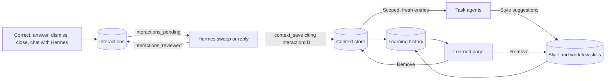

# Learning from the user's interactions

**Status** — Implementation contract for [US-40](../user-stories.md). Builds on the [context store](context-and-schedules.md) and the [writing style and skills](delegation-and-style.md#learning-the-users-writing-style).

Every time the user corrects a draft, answers a question, dismisses or closes a task, or writes to Hermes, they are teaching. MeMyselfAI records each of these **interactions** as it happens. Hermes reviews the ones it has not seen yet and turns the lasting ones into context entries, which every later task agent in scope receives. Writing-style and workflow skills keep learning as before.

Every change to what agents know is written to an append-only **learning history**. The user can read it newest first to see how agents evolved, and remove any lesson that is still in effect. A removed lesson stays in the history and is never silently relearnt.

## Interactions

The app records one interaction for each of these, with the time, the task, its project and the user's words:

| Kind | Recorded when |
| --- | --- |
| `correction` | The user sends feedback on a task |
| `answer` | The user answers a task's question, by typing or picking a choice. Choosing a checkout or a calendar account is not recorded |
| `dismissed` | The user dismisses a task |
| `closed` | The user closes a task they handled themselves |
| `chat` | The user writes to Hermes |

An interaction is pending until Hermes marks it reviewed. Pending interactions older than 14 days are no longer offered. Interaction text is the user's own, but the task title next to it may come from connected activity and is untrusted.

## How Hermes learns

Two orchestrator tools on the [app MCP server](agents-and-app-mcp.md#the-app-mcp-server) serve this. A task session neither lists nor can call them.

| Tool | Effect |
| --- | --- |
| `interactions_pending(limit)` | Up to 50 pending interactions, oldest first, each with its id, kind, text, task title and project |
| `interactions_reviewed(ids)` | Marks the interactions reviewed, whether or not they taught anything |

In every sweep, Hermes calls `interactions_pending`. For each interaction that reveals something lasting, such as a preference, a fact about a person, or how the user wants a kind of work handled, it calls `context_save` and lists `interaction:ID` among the sources. A one-off correction for a single task teaches nothing lasting. It then marks every interaction it looked at as reviewed. When the user writes to Hermes, the reply run does the same for what the user said. New pending interactions make the next sweep due.

Task agents learn by receiving these entries, as the [context store](context-and-schedules.md#access-by-task-agents) describes. They also keep proposing style changes, which stay pending until the user approves them.

## Learning history

Each record has a time, the author (`hermes`, `agent` or `user`), an action, the target (a context entry or a skill revision), the kind, subject and project, the text before and after, a reason and the sources.

| Action | Written when |
| --- | --- |
| `learned` | A context entry is created, or an active workflow revision is applied |
| `updated` | Saving a context entry changes its body. A save that only refreshes the review date writes nothing |
| `proposed` | A style suggestion awaits the user's approval |
| `approved` | The user approves a style suggestion |
| `retired` | Hermes or the user retires a context entry |
| `restored` | The user restores a retired or removed context entry |
| `removed` | The user removes a lesson from the history |
| `declined`, `reverted` | The user declines a style suggestion or reverts a skill revision |

The **Learned** page lists the history newest first, with the author, what changed, the earlier text for an update, the reason, and a link to each task an interaction came from. A filter shows only Hermes, task agents or the user.

## Removing a lesson

Records whose target is still in effect show **Remove**. In effect means an active context entry, an active skill revision or a pending style suggestion.

- Removing a context entry gives it status `removed`. Task agents stop receiving it from the next request. `context_save` with the same kind, subject and project is refused with a message telling Hermes the user removed it. Restoring it from Context lifts the block.
- Removing an active skill revision reverts it, and removing a pending style suggestion declines it. The rules are the same as on Skills & style, so the initial discovery skill cannot be removed.
- Removing writes a `removed` record. Earlier records stay unchanged.

## Acceptance criteria

- Sending feedback, answering a question, dismissing a task, closing a task and writing to Hermes each create one pending interaction with the user's words. Choosing a checkout does not.
- Through an orchestrator session, `interactions_pending` lists them and `interactions_reviewed` removes them from the list. A task session's tool list has neither tool.
- A new context entry writes `learned` by Hermes. Saving the same entry with a new body writes `updated` with both texts. Saving it unchanged writes nothing new.
- After the user removes an entry from the Learned page, the next task agent in that project does not receive it. Hermes saving it again is refused. Restoring it allows saving again. The history shows `learned`, `removed` and `restored` in order.
- A style suggestion from a task agent writes `proposed` by an agent. Removing it declines it. Reverting an active workflow revision from the history restores the previous one.
- A pending interaction makes a sweep due, even when no task or event changed.
