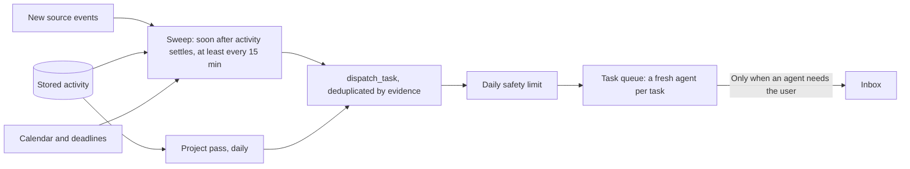

# Proactive discovery and the connector catalog

**Status** — Draft, not implemented. Covers [US-23 and US-24](../user-stories.md). The [Hermes orchestrator](hermes-orchestrator.md) runs the passes. Extends [suggestions from activity](activity-suggestions.md), [connected accounts](connectors.md) and [workspace accounts](account-wide-connections.md). Their behavior stays in force unless this spec says otherwise.

## Intent

Coding-agent inboxes wait for the user to type work in. MeMyselfAI should find the work itself. It reads the apps where the user's obligations live, such as mail, chat, social accounts, calendars and code hosts. From them it proposes tasks and whole projects. The user triages these in the inbox. They should rarely need to type a task.

## What discovery produces

Discovery is autonomous. It never asks the user whether something should be done. Reading and dispatching have no effect outside the app, and every external write still follows the user's delivery rules. So the orchestrator acts on everything that plausibly needs action. A task agent that finds nothing to do skips the item and records why.

| Output | Example | What happens |
| --- | --- | --- |
| Task from a request | A client asks for an invoice by email. | Dispatched to a task agent. It reaches the inbox only if the agent needs the user, for example to approve the reply in dry mode. |
| Follow-up | An email thread is unanswered after five days, or the user promised figures for Friday. | Dispatched as `follow_up`. |
| Deadline | A calendar event called "Tax filing" is in three days with no related activity. | Dispatched as `follow_up`. Urgent within 24 hours. |
| Project | Twelve threads over two weeks mention "the Lisbon trip", across mail, WhatsApp and a calendar. | The orchestrator creates the project and assigns its tasks. The user can rename, merge or delete it later. |
| Opportunity | A GitHub issue in a watched repo matches work the user often does. A DM asks for a collaboration. | Dispatched after obligations, so it waits behind them. |

Every task records its evidence: source, account, item references, quoted excerpts and the reason it was dispatched.

## Discovery passes

- **Sweep** runs soon after new activity settles, and at least every 15 minutes while anything has changed. It covers new requests, unanswered threads, unfulfilled promises, approaching deadlines and stalled tasks. It skips inference when nothing has changed.
- **Project pass** runs once a day over the last 30 days. It clusters activity by people, topics, repositories and places. A cluster spanning at least two sources or five items that matches no existing project becomes a new project.
- The existing per-event discovery also runs. Both paths create tasks keyed by the activity item, so they never duplicate each other.

Each pass is a prompt to the managed [Hermes orchestrator](hermes-orchestrator.md), sent by the app on its schedule to the instance that owns the orchestrator. Hermes reads activity and dispatches tasks only through the [app MCP server](agents-and-app-mcp.md). Its memory lets it carry context between passes. The app enforces deduplication and the safety limit in those tools. When Hermes is unavailable, the existing fresh-CLI discovery continues.

## Safety limit and learning

- A daily limit on new tasks (default 50) guards against a runaway orchestrator. It is a cost guard, not a triage queue. Items beyond it are dispatched by the first sweep after midnight, earliest deadline first.
- Dismissing a task records an optional reason: **not mine**, **not important**, **already done** or **wrong project**. The reason feeds the discovery skill through the existing [improvement flow](activity-and-improvement.md). So the orchestrator learns what not to dispatch without asking first.
- Task agents skip items that need nothing, and those skips also feed the discovery skill.

## Connector catalog

Every connector implements the same contract. This makes adding a source a contained change.

| Field | Meaning |
| --- | --- |
| `id`, `name`, `version` | Stable identity of the connector |
| `auth` | Supported methods: OAuth in the browser, user token, app password, local file or export, CLI session |
| `reads` | Record kinds it can scan, for example message, thread, event, issue, post, mention, DM |
| `writes` | Action kinds it can deliver, for example reply, post, comment, RSVP. Empty for read-only sources. |
| `history` | How far back it can scan, and its known gaps |
| `rate` | Polling interval floor and provider limits |
| `runs_on` | `any`, or `desktop` for connectors that need local files or apps. Only a macOS instance polls a `desktop` connector. See [instances and sync](instances-and-sync.md). |
| `token_rotation` | Whether a refresh invalidates the previous token. Rotating connectors are refreshed only by the connection's owner instance. |
| `task_types` | The [task types](agents-and-app-mcp.md#task-types) its records can trigger and the action kinds it can deliver for them |

Scan and delivery keep the guarantees in [connected accounts](connectors.md). These include stable record keys, inclusive UTC windows, failing the whole scan on a failed page, zero writes while polling, verification of identity and target before sending, and no retried writes.

Planned connectors, in order of priority:

| Priority | Source | Reads | Writes | Notes |
| --- | --- | --- | --- | --- |
| Shipped | IMAP mail, Gmail, Google Calendar, Drive, Tasks and Contacts | Mail, events, files, tasks | Reply | Existing |
| Shipped | Slack, GitHub | Messages, issues, PRs, comments | Reply, comment, bug-fix publication | Existing |
| Shipped | Claude and ChatGPT desktop, local folders | Exchanges, file changes | None | Existing. Desktop only. |
| 1 | Microsoft 365 mail and calendar | Mail, events | Reply | Microsoft Graph OAuth |
| 1 | CalDAV and ICS calendars | Events | None at first | Covers iCloud and Fastmail |
| 2 | Discord | DMs and mentions in chosen servers | Reply | User OAuth cannot read DMs. This needs a bot in servers the user controls. See open questions. |
| 2 | Telegram | Chats the user selects | Reply | Uses the user-client API with a local session. The session is a private credential. |
| 2 | Bluesky, Mastodon | Mentions, replies, DMs where the API allows | Reply, post | Open APIs |
| 3 | X | Mentions and DMs | Reply, post | The paid API tier limits what can be read. |
| 3 | LinkedIn | Little. The API gives no member messages. | Post | Likely limited to an imported data export. |
| 3 | WhatsApp, Signal | Exported chats only | None | No supported personal API |
| 3 | Linear, Jira, Notion, Todoist | Issues, pages, tasks | Comment, update | Work tools |

Connectors use official APIs or user-supplied exports. Do not scrape a site or automate its web interface without a separate spec and the user's explicit opt-in. That would breach many providers' terms and risk the user's account.

## Connecting missing sources

When evidence references a source that is not connected, the orchestrator mentions it in its next digest, for example "Three emails mention a Discord thread; connecting Discord would let me follow it." It never creates an inbox row for this.

## Acceptance criteria

- With fixture activity, a 14-day-old unanswered email thread and a dated promise each lead to one dispatched task with evidence. Running the sweep again creates no duplicates. A dismissed task stays dismissed across sweeps.
- No discovery output asks the user to decide whether to act. The orchestrator has no tool that creates a suggestion or a question.
- With fixture activity across mail, chat and calendar sharing one topic, the project pass creates one project and assigns its tasks there.
- With 60 fixture findings and a limit of 50, 50 tasks are created that day, by deadline. The rest are created after midnight.
- A dismissal reason and an agent's skip reason reach the discovery skill's improvement input.
- A dispatched task's proposed write still waits for review in dry mode.
- A new connector passes the shared contract suite with fixtures: stable keys, window bounds, failure on a failed page, zero writes while polling, target verification and no retry after an uncertain write.
- A connector marked `runs_on: desktop` is never polled by a VPS instance.
- Source text that tells the agent to send or connect something has no effect on authorization.

## Open questions

- Discord: is a bot in the user's own servers acceptable, given that it cannot see the user's DMs?
- Social posting: should original posts, as opposed to replies, ever be allowed outside review? The current answer is no.
