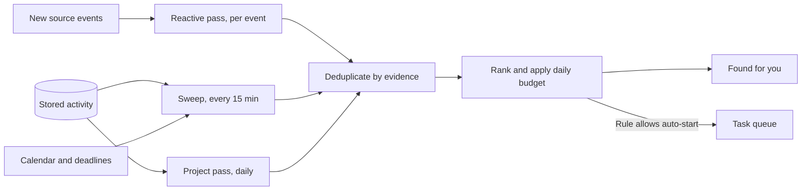

# Proactive discovery and the connector catalog

**Status** — Draft, not implemented. Covers [US-23 and US-24](../user-stories.md). The [Hermes orchestrator](hermes-orchestrator.md) runs the passes. Extends [suggestions from activity](activity-suggestions.md), [connected accounts](connectors.md) and [workspace accounts](account-wide-connections.md). Their behavior stays in force unless this spec says otherwise.

## Intent

Coding-agent inboxes wait for the user to type work in. MeMyselfAI should find the work itself. It reads the apps where the user's obligations live, such as mail, chat, social accounts, calendars and code hosts. From them it proposes tasks and whole projects. The user triages these in the inbox. They should rarely need to type a task.

## What discovery produces

| Output | Example | Inbox treatment |
| --- | --- | --- |
| Task from a request | A client asks for an invoice by email. | Needs you once prepared. If a rule allows starting without triage, it is never shown untriaged. |
| Follow-up | An email thread is unanswered after five days, or the user promised figures for Friday. | Found for you, with evidence. |
| Deadline | A calendar event called "Tax filing" is in three days with no related activity. | Found for you. Urgent within 24 hours. |
| Proposed project | Twelve threads over two weeks mention "the Lisbon trip", across mail, WhatsApp and a calendar. | One "New project?" row. Options: create it with the listed sources and people, merge into an existing project, or ignore the topic. |
| Opportunity | A GitHub issue in a watched repo matches work the user often does. A DM asks for a collaboration. | Found for you, ranked below obligations. |

Every output records its evidence: source, account, item references, quoted excerpts and the reason. Discovery never acts on an output. Accepting it creates a task. That task follows the [task workflow](task-workflow.md).

## Discovery passes

- **Reactive** runs for each new event, as today.
- **Sweep** runs every 15 minutes over stored activity from the last 14 days. It looks for unanswered threads, unfulfilled promises, approaching deadlines and stalled tasks. It skips inference when evidence has not changed since its last run. The existing five-minute, three-hour suggestion scan becomes the sweep's short window.
- **Project pass** runs once a day over the last 30 days. It clusters activity by people, topics, repositories and places. A cluster becomes a proposed project only if it spans at least two sources or five items and does not match an existing project.

Each pass is a prompt to the managed [Hermes orchestrator](hermes-orchestrator.md), sent by the app on its schedule to the instance that owns the orchestrator. Hermes reads activity, proposes findings and dispatches tasks only through the [app MCP server](agents-and-app-mcp.md). Its memory and skills let it carry context between passes. The app enforces deduplication and the budget in those tools. When Hermes is unavailable, each pass falls back to a fresh CLI run with bounded input, as in the [local agent contract](local-agent.md). The project pass returns the cluster's name, a one-line description, member evidence, suggested sources, people and repositories, and a confidence.

## Budget and learning

- The user sets a daily budget for untriaged found rows. The default is 10. Obligations rank above opportunities. Within a rank, earlier deadlines come first. Rows over budget wait. They are never dropped silently, and the Activity view lists them.
- Dismissing a found row asks for an optional reason with one keypress: **not mine**, **not important**, **already done**, **wrong project**. The reason feeds the discovery skill through the existing [improvement flow](activity-and-improvement.md).
- Ignoring a topic suppresses project proposals for that cluster until new activity changes its membership by more than half.
- A project rule can let a decision kind start without triage, for example "requests from my team in Slack". Discovery then queues those tasks directly. Delivery rules are unchanged.

## Connector catalog

Every connector implements the same contract. This makes adding a source a contained change.

| Field | Meaning |
| --- | --- |
| `id`, `name`, `version` | Stable identity of the connector |
| `auth` | Supported methods: OAuth in the browser, user token, app password, local file or export, CLI session |
| `reads` | Record kinds it can scan, for example message, thread, event, issue, post, mention, DM |
| `writes` | Action kinds it can deliver, for example reply, post, comment, RSVP. Empty for read-only sources. |
| `history` | How far back it can scan, and its known gaps |
| `rate` | Polling interval floor and provider limits |
| `runs_on` | `any`, or `desktop` for connectors that need local files or apps. Only a macOS instance polls a `desktop` connector. See [instances and sync](instances-and-sync.md). |
| `token_rotation` | Whether a refresh invalidates the previous token. Rotating connectors are refreshed only by the connection's owner instance. |
| `task_types` | The [task types](agents-and-app-mcp.md#task-types) its records can trigger and the action kinds it can deliver for them |

Scan and delivery keep the guarantees in [connected accounts](connectors.md). These include stable record keys, inclusive UTC windows, failing the whole scan on a failed page, zero writes while polling, verification of identity and target before sending, and no retried writes.

Planned connectors, in order of priority:

| Priority | Source | Reads | Writes | Notes |
| --- | --- | --- | --- | --- |
| Shipped | IMAP mail, Gmail, Google Calendar, Drive, Tasks and Contacts | Mail, events, files, tasks | Reply | Existing |
| Shipped | Slack, GitHub | Messages, issues, PRs, comments | Reply, comment, bug-fix publication | Existing |
| Shipped | Claude and ChatGPT desktop, local folders | Exchanges, file changes | None | Existing. Desktop only. |
| 1 | Microsoft 365 mail and calendar | Mail, events | Reply | Microsoft Graph OAuth |
| 1 | CalDAV and ICS calendars | Events | None at first | Covers iCloud and Fastmail |
| 2 | Discord | DMs and mentions in chosen servers | Reply | User OAuth cannot read DMs. This needs a bot in servers the user controls. See open questions. |
| 2 | Telegram | Chats the user selects | Reply | Uses the user-client API with a local session. The session is a private credential. |
| 2 | Bluesky, Mastodon | Mentions, replies, DMs where the API allows | Reply, post | Open APIs |
| 3 | X | Mentions and DMs | Reply, post | The paid API tier limits what can be read. |
| 3 | LinkedIn | Little. The API gives no member messages. | Post | Likely limited to an imported data export. |
| 3 | WhatsApp, Signal | Exported chats only | None | No supported personal API |
| 3 | Linear, Jira, Notion, Todoist | Issues, pages, tasks | Comment, update | Work tools |

Connectors use official APIs or user-supplied exports. Do not scrape a site or automate its web interface without a separate spec and the user's explicit opt-in. That would breach many providers' terms and risk the user's account.

## Connecting from the inbox

Connections keeps its page. Discovery also asks for missing sources from the inbox. When evidence references a source that is not connected, discovery can produce one row such as "Three emails mention a Discord thread. Connect Discord?" Its options are **Connect**, **Not now** and **Never for this source**. That row does not count toward the budget more than once a week.

## Acceptance criteria

- With fixture activity, a 14-day-old unanswered email thread and a dated promise each produce one found row with evidence. Running the sweep again produces no duplicates. Dismissing a row keeps it dismissed across sweeps.
- With fixture activity across mail, chat and calendar sharing one topic, the project pass proposes one project with its members. Accepting it creates the project and assigns its existing tasks there. Ignoring the topic suppresses it until membership changes by more than half.
- With 15 fixture findings and a budget of 10, the inbox shows 10, ranked by kind and deadline. Activity lists the other five.
- A dismissal reason reaches the discovery skill's improvement input.
- A rule allowing auto-start queues a matching task without a found row. Its proposed write still waits for review in dry mode.
- A new connector passes the shared contract suite with fixtures: stable keys, window bounds, failure on a failed page, zero writes while polling, target verification and no retry after an uncertain write.
- A connector marked `runs_on: desktop` is never polled by a VPS instance.
- With Hermes stopped, each pass still runs through the CLI fallback and produces the same found rows for the same fixtures.
- Source text that tells the agent to accept, send or connect something has no effect on authorization.

## Open questions

- Discord: is a bot in the user's own servers acceptable, given that it cannot see the user's DMs?
- Social posting: should original posts, as opposed to replies, ever be allowed outside review? The current answer is no.
- Should the daily budget be per project as well as per workspace?
