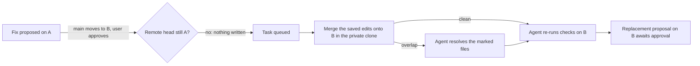

# Task agents and completion

**Status** — Draft. Covers [US-07, US-08, and US-09](../user-stories.md).

## One agent per task

When a task becomes actionable, the app spawns a fresh agent through the local AI CLI. The agent receives the task's project, source references, instructions, applicable decision rules, and completion criteria. Its progress belongs to the task and survives a CLI exit. On retry, the app restores that progress and checks existing receipts before resuming. Two workers must never dispatch the same task action concurrently.

Each coding task gets a private clone of the selected checkout, starting where the [task start point](#task-start-point) says. Its branch, Git objects and working files live together under app storage. Retries reopen that clone even if the source folder has moved. Older linked worktrees migrate on use, preserving their revision and local edits. A task can run local commands in its private workspace and use their exit status and output as completion evidence. Existing tasks waiting for the user to run commands or blocked by a Git preparation permission error receive one new preparation attempt.

### Task start point

A task's private clone starts from the code the task is about, not from whatever branch the user's folder happens to be on.

- **Pull request work** starts at the pull request's head, `refs/pull/<n>/head`, fetched from the folder's origin. The number comes from the task's GitHub event or a step ancestor's event. Without one, it comes from a single pull request named in the title, such as `PR #316` or `PR repo#316`, or failing that in the body. Two different numbers in the same text count as none.
- **Other work**, including GitHub issues and bug fixes, starts at the origin's current default branch. That is the revision the bug workflow checks before publishing a fix.
- **Offline or refused fetches** fall back to the folder's own `origin/HEAD` (or `origin/main`, then `origin/master`), and finally to the folder's HEAD.

The fetch uses the user's own Git setup and credentials, reads only, and writes into the private clone. The user's folder keeps its branches, refs and files. The clone records where it started in `memyselfai.start` and any pull request number in `memyselfai.pull`. An existing clone keeps its branch, so retries and resumed tasks are unchanged, except that an unpublished fix follows the default branch as described in [resuming after the default branch advances](#resuming-after-the-default-branch-advances). A clone made to receive a handed-over task keeps the handed-over commit. When its base commit is missing and the task works on a pull request, the receiver fetches that pull request's head as well.

Acceptance, verified in `tests/test_worker.py` and `tests/test_sync.py` with a bare origin and a folder on a feature branch whose `origin/main` is behind:

- A prepared task starts at the origin's current default branch, not the folder's feature branch.
- A pull request task starts at the pull request's head.
- With the origin unreachable, the task starts at the folder's `origin/main`.
- Without the start point option, as in handoff imports, the clone starts at the folder's HEAD.
- The folder's refs and current branch are unchanged afterwards.
- The pull request number is read from a title, from an ancestor's GitHub event, and is absent for issue work or for two different numbers.

## Global work and project repositories

Every workspace has a built-in Global scope for general computer tasks. Creating a task requires only a title. Named projects group related work and can contain child projects and zero or more Git checkouts. Global is the root. A project can be moved under another project. Reject moves that would create a cycle. A group can draw on its descendants’ checkouts; when a GitHub source matches a parent and its child, prefer the more specific child. Connections remain workspace-wide. Existing projects, including Personal, retain their tasks and rules when upgraded. A legacy single checkout becomes a one-entry list. If a named Global already exists, the built-in scope gets a distinct name. Rules continue to apply to their own scope.

Discovery prefers a unique named project containing the source GitHub repository. Unmatched work defaults to Global. Coding tasks in Global may use a registered checkout from any project. A task works in one isolated checkout. Prefer the source repository, explicit repository evidence, or the sole checkout of a named project. When the target is ambiguous, ask through a decision agent before preparing edits. Continue independent work. After selection, retries and publication use the same checkout.

For a connected GitHub task without a matching registration, look for the repository folder under selected activity folders, beside registered checkouts, and in common local development folders including Documents. Search a bounded number of directory levels, skip symbolic links and app storage, and verify the full owner/repository against Git origin. Use a unique verified checkout automatically. For newly discovered work in Global, group it under an existing matching project or create a project named for the verified owner/repository. Existing Global repository questions can join that project when they have no linked task family or project decision rules to preserve. An existing explicit project keeps its scope.

Verify that an already waiting task and a newly discovered issue use the matching private clone without a settings visit. A namesake from another owner, an ignored folder and a disconnected source cannot supply a checkout. Two matching copies offer distinct path choices in the queue and show their full paths in task details. When no eligible local checkout exists, the user can choose a folder directly from the task.

Verify a fresh workspace and an upgraded workspace, a non-coding task without a repository, selection of the second repository in a group, and clarification when several repositories fit. The project editor uses the native folder picker to add or replace each repository and supports removing a link.

When a GitHub issue or pull request has a uniquely matching registered checkout, its first task agent receives the selected repository path, the verified task worktree and bounded file context even if discovery called it a generic task. A decision about that work receives the same checkout identity. When repository selection is the only pending question, saving project settings or reopening the app rechecks the current registrations and resumes preparation on a unique match. Ambiguous, disconnected and ignored repositories remain ineligible for automatic resumption. A pull request task, such as a review or a request to verify and merge, gets that checkout at the pull request's head even when its kind is not coding, so its agent runs the pull request's tests there instead of in an empty app folder. Verified by `tests/test_bug_integration.py`. Users can retry a preparation question after supplying missing context through project settings.

A local task in a named project can see its matching checkout during classification. If the task needs code, the app prepares an isolated worktree on the next pass.

If Git cannot inspect a registered folder because access is denied or the read times out, the task identifies that folder and offers a retry. The dashboard remains usable while macOS asks for folder access.

## Resuming preparation when local evidence is available

A delegated step receives its parent's request, recent answers and available results from related steps in the same project. When the parent has a uniquely identified registered checkout, the step prepares its own private clone from it. Each agent uses the files named in its instructions first. A request for additional files can trigger one more bounded read from that worktree. The worker reports unavailable files and the applicable limits.

Verify that a named file after 24 other files reaches the worker. A waiting parent or delegated step gets another preparation pass when a related step finishes or a parent answer arrives, including across restart. An unchanged result cannot cause a retry loop. Upgrade recovery retries existing checkout and parent-context questions when a matching registration is available. Genuine user decisions, ignored work, disconnected sources and pending deliveries retain their normal controls.

Git timeouts during local preparation receive two delayed retries. A persistent timeout leaves the task available for manual retry with the folder and error recorded.

If macOS blocks reading the registered repository's identity, the scheduler checks it in the background once per recovery pass and shares the result across waiting tasks. Granting folder access resumes eligible tasks without a settings change or restart.

## Evidence of completion

| Task | Evidence required to mark it complete |
| --- | --- |
| Bug report | An open issue records the bug. A PR containing the fix links to the issue and the hosting provider reports the PR is mergeable. A delivered message tells the original reporter where to find the fix. The task can finish before the PR is merged. |
| Email requesting information | The agent identifies each requested element, checks that the outgoing answer covers each one, and records successful delivery of that answer. Missing information leaves the task open for clarification. |
| Commitment | The promised outcome has been delivered according to the follow-up task's own completion criteria. |

Completing one external action advances the task. The agent checks the remaining criteria before marking the whole task complete. In dry mode, a prepared issue, PR, notification, or email can await confirmation while the dashboard shows which criteria are still outstanding.

Coding work on an open GitHub issue follows the same workflow. When the agent reports it finished and has saved edits, the task becomes a bug fix: it proposes the fix branch and then the PR for approval, instead of closing as done. The edits never stay unpublished in a private clone. When the user wrote the issue, the verified PR completes the task without a notification to themselves. Earlier builds closed such tasks as done. On start the app reopens each one whose issue is still open and has no branch, PR or receipt. It sets the old clone aside under app storage, keeping its files, and redoes the work from the current default branch, because publishing needs that base.

The desktop bug workflow verifies the worktree's origin and HEAD against the configured GitHub repository and its default branch before publishing a fix. When the default branch has moved on since the task started, GitHub must report it strictly ahead of the worktree's HEAD and none of its newer commits may change, rename or replace a path the fix edits; the fix is then published on the current default branch revision. Newer commits touching an edited path, a diverged or unpublished HEAD, or a comparison of 300 or more files stop preparation with a message naming the reason, and the conflicting paths when there are any. The branch preview names the repository, base revision, commit message, paths, file modes and full contents. It also carries, for each file, a unified diff of the proposed replacement against that file at the worktree's HEAD, which matches the recorded base for every edited path, with added and removed line counts. As in Git, lines end only at a newline, so form feeds, lone carriage returns and Unicode line separators stay inside a line. A file absent at HEAD is a new file and shows only additions. A per-file diff is cut at 400 lines and marked as shortened; the counts and the full content stay complete. A current file that is not UTF-8 text gets no diff. The diff lives only in the preview: the published tree is built from the exact path, mode and content entries. A moved base or a newly assigned issue pauses delivery. The PR must target the recorded base from the published fix branch and revision and link the original open issue. The reporter receives the PR URL by email, in the original Slack thread, or in the GitHub conversation with the reporter mentioned. An uncertain notification remains open until reconciled.

### Resuming after the default branch advances

A fix prepared on default branch revision A can wait for approval while the default branch moves to B. The task keeps its issue, history and private clone, and prepares a replacement proposal on B instead of failing against A on every retry.

- **Approval of a stale proposal.** The executor reads the remote default branch head before writing. If it is no longer the proposal's base, nothing is written and the task returns to the queue with the reason "The default branch moved; preparing a replacement fix on its new head". It does not fail. That version can no longer be approved. A preparation that finds newer commits touching an edited path does the same once. If the next pass still cannot move the edits, as when the folder has not fetched the new head, the task fails with that reason and waits for a retry.
- **Recorded base.** Saved edits record the clone revision they were written against as `changes_base`. Edits saved by an earlier build without one get the clone's HEAD recorded at the start of the next preparation, before any refresh can move it. A proposal is refused, before any write, when `changes_base` is missing or differs from the clone's HEAD, so edits written on A are never published as full contents on B.
- **Refresh.** A GitHub issue or bug task that has saved edits, no published branch and no pull request start point checks the default branch during preparation. It fetches it the way the [task start point](#task-start-point) does: the origin's default branch, or offline the folder's own `origin/HEAD`, `origin/main` or `origin/master`. So "available locally" means the maintainer's checkout has fetched it. An older copy never moves the clone back. The fetch runs at most every 10 minutes, except right after a moved base was detected. It also waits while overlapping edits are unresolved. When the head is newer, the app keeps the saved edits as a commit on their base at `refs/memyselfai/before-refresh/<base>`, one ref per base, so a later refresh never overwrites an earlier one. It three-way merges each saved file: the version at the recorded base, the saved full text, and the version at the new head. It computes all merges before touching the clone. Then it moves the task branch to the new head, writes the merged files as unstaged changes, and records the new `changes_base` and `memyselfai.start`. Only the saved changes are carried over. Untracked scratch files stay in place, and other uncommitted edits to tracked files are dropped. The task log records "Moved to the new default branch". The user's folder is only read: its branches, index and uncommitted files are unchanged.
- **Interrupted refresh.** The task's saved changes and `changes_base` stay the source of truth until the refresh is saved. If it stops partway, for example on a crash, a timeout or a failed write, the clone's HEAD no longer matches `changes_base`. The next pass redoes the refresh from the saved edits, even without a fetch. A merge failure that is not a conflict raises before the clone moves.
- **Clean replay.** Edits to other parts of a file the new head also changed carry both. Earlier verification is cleared because it ran on the old base. The agent runs again with `base_moved` in its context and is asked to re-run the relevant checks on the new base.
- **Overlapping edits.** An overlapping file stays among the saved changes with Git conflict markers. It is named in `base_moved.conflicts` and in the task log, and the agent receives it to resolve by full replacement. A path leaves `base_moved.conflicts` only when the agent saves new content for it without markers. While any conflict remains, the task cannot finish or propose anything. An answer that leaves one unresolved fails the task, naming the files, and a retry runs the agent again. Earlier conflicts carry forward. If the default branch moves again before they are resolved, the clone stays where it is until they are. A proposal is never prepared while any edited file contains a line starting with `<<<<<<<` or `>>>>>>>`.
- **Fresh approval.** The replacement is a new action version on the new base. In dry mode it waits for approval like any other branch publication; the earlier approval does not carry over.
- If the default branch is still unavailable locally, the existing moved-base check applies. A proposal on the new head is allowed only when the newer commits leave the edited paths alone.

Acceptance, verified in `tests/test_worker.py`, `tests/test_bugflow.py` and `tests/test_bug_integration.py`:

- With the default branch advanced after preparation, approving the old proposal produces no remote write and queues the task. The old version cannot be approved afterwards.
- With the remote fetch offline, after the folder's `origin/main` reaches B, the same task prepares a proposal whose base is B and keeps its event and history. It publishes only after the replacement is approved, with B as the commit's parent.
- An edit that overlaps B's change to the same lines reaches the agent with conflict markers and its path in `base_moved.conflicts`. The resolved content becomes the replacement proposal.
- A non-overlapping change in the same file is merged. A clone already at the default branch head is left unchanged. An older offline copy does not move it back.
- A refresh that fails after moving the branch is redone on the next pass from the saved edits. For a bug task whose milestones skip the agent, the proposal then holds both the fix and B's change, never the A-based contents. The same holds for edits saved without a `changes_base`. Edits whose `changes_base` is missing or differs from the clone's HEAD are refused.
- A merge failure raises before the clone moves.
- A `done` answer that leaves an overlapping file unresolved fails without any write and keeps the conflict. A second move of the default branch while it is unresolved keeps the conflict and the clone's base. After resolution, the proposal goes on the newest head.
- Each refresh keeps its own `refs/memyselfai/before-refresh/<base>` snapshot without untracked scratch files. The maintainer's uncommitted file and refs are unchanged.
- Saved changes containing conflict markers are rejected before any write.

Not verified here: a real GitHub repository and network fetch; the fixtures use a local bare origin and a fixture GitHub transport.

## Checks this machine cannot run

A task never waits for the user to run a build or a test, or to say whether one passed. Its agent runs the check itself, moves the task to an instance that can, or notes what stays unverified and carries on.

- **Run it here.** The agent knows which machine it is on from `platform` (`macos` or `linux`). It runs what it can with local commands. The app records each command's exit code, timeout and platform on the task as `verification`.
- **Move to a fitting instance.** For a check that needs another kind of machine, such as the Mac app build on the Linux server, the agent returns `needs_platform`. If a reachable, eligible paired instance of that kind can take the task, the app saves any prepared files, queues the task with that requirement and hands it over through the normal [capacity handoff](instances-and-sync.md#dividing-work), worktree included. Each instance advertises its `platform` in its capacity. Only a fitting instance can take or keep such a task. The receiver runs the agent with the check available and clears the requirement after that run.
- **Note it and continue.** If no fitting instance is reachable, or none takes the task within 30 minutes, the task runs where it is with `verification_unavailable`. The agent lists each check it could not run in `unverified` and finishes with done or draft. It never turns the check into a question. The app keeps that list on the task, appends it to a done result as **Still to verify**, and the bug workflow's pull request lists it under **Not verified yet**. A task falls back like this only once, so a missing Mac cannot loop it between instances.
- The bug workflow's pull request ends with a **Verification** section the app writes, not the agent: every command run and its exit code and platform, or a line saying none ran, then anything not verified yet.
- [AGENTS.md](../../AGENTS.md) step 6 tells agents on a machine that cannot build the Mac app to move the task or note the build, never to ask.

Acceptance, verified in `tests/test_engine.py` and `tests/test_bugflow.py`:

- On Linux with a reachable Mac peer, `needs_platform: macos` queues the task for the Mac, asks no question, and only a Mac capacity can take it. The scheduler here does not start it while that Mac can take it.
- With no Mac peer, the same answer queues the task to run again here with `verification_unavailable`. The agent then receives that fact, and its `unverified` list lands in the result. A second `needs_platform` is not acted on.
- A task held for a Mac that no Mac takes within 30 minutes runs here and is told no Mac is reachable.
- The pull request body lists each command with its exit code and platform, says when none ran, and lists the unverified checks.

Not verified here: a real handoff between a paired Linux server and a Mac. The ownership handoff itself is covered by the existing sync tests.

## Promises become work

When drafting a commitment such as “I'll send the figures on Friday,” show the promised work and timing alongside the proposed message. Once the message is delivered, create a linked follow-up task for each distinct promise, with the project, beneficiary, source message, and any stated deadline or trigger. The scheduler makes the follow-up actionable in time to address it. Where timing or scope is unclear, ask for clarification. Reconcile uncertain delivery before activating the follow-up. Discarding a draft discards its proposed commitments. A commitment already made by the user in connected content also creates a follow-up when discovered.

## Acceptance criteria

- Two distinct tasks start distinct CLI agents. Verify that their branches and Git metadata live under app storage, that the source retains its original refs and uncommitted changes, and that a retry succeeds after moving the source. Migrate an earlier linked worktree with staged, unstaged and deleted files. A task waiting on command access retries once and receives actual command output.
- Given an existing issue and linked PR after a restart, the agent resumes from the missing evidence. A conflicting PR or an undelivered reporter notification keeps the bug task open.
- Given an email requesting a price and delivery date, sending only the price leaves the task incomplete. A delivered answer covering both satisfies the task.
- A sent email promising a Friday update can complete the email task and leave a separate Friday follow-up open. Replaying the delivery event or rediscovering the same sent message produces one follow-up for that promise.
- A coding task on an open GitHub issue that finishes with edits proposes a fix branch, then a PR. On the user's own issue, the verified PR completes it with no notification write. After an upgrade, a task closed as done with unpublished edits for a still-open issue is queued again once, with its clone set aside.
- A mismatched repository, branch revision, file type, PR head, or issue link prevents completion. A default branch that moved on without touching the edited files yields a preview based on its current revision, verified in `tests/test_bugflow.py`; one that changed an edited or renamed file, or diverged, stops before any write until the task has [moved onto the new default branch](#resuming-after-the-default-branch-advances). An executable script keeps its tracked mode in the published branch. In a fixture repository, `tests/test_bugflow.py` checks that a one-line replacement previews as one removed and one added line with three lines of context, a new file as additions only, an executable file with mode 100755, and a 2,000-line rewrite as a shortened diff with complete counts. A file containing a form feed, U+2028 and a CRLF line yields the same hunk as `git diff`. `tests/test_bug_integration.py` checks the diff in the end-to-end flow and that approving an older version of the branch proposal is refused without a write. If the final reporter message fails, receipt of a branch or PR alone cannot close the task.
