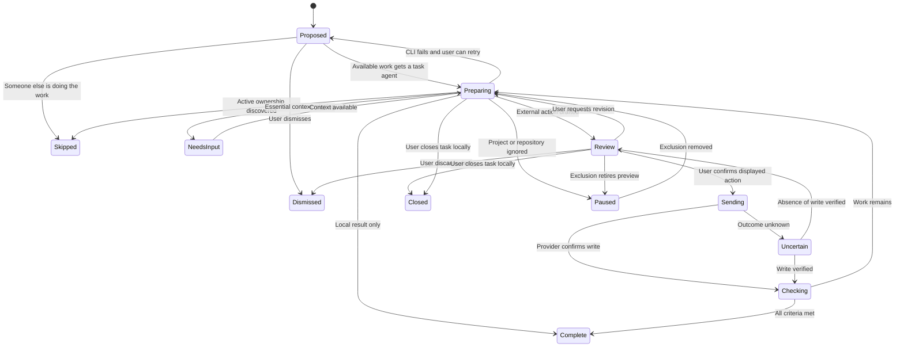

# Task discovery, preparation, and approval

**Status** — Draft. **Scope** — [US-01 through US-05 and US-13](../user-stories.md).

## Behavior

The user connects accounts and sees their connection state in the dashboard. Incoming activity and proactive review of existing activity can each surface a task. A task records its source account, a reference to the original item, the reason it surfaced, and whether a new event or a proactive review triggered it. Reprocessing the same evidence for the same follow-up updates the existing task. Dismissal persists across repeated scans of that evidence.

When a task surfaces, the agent chooses a next step and uses the local CLI to prepare the work, even while the dashboard is closed and the app is running. The user may add context, correct the approach, or dismiss the task. If essential information is missing, the agent identifies what it needs and continues with other tasks. Preparation may produce a local result, such as a summary, or one or more proposed external actions. A summary can complete the task locally. In dry mode each proposed external action waits independently for review. The preview includes the operation, sending account, recipients or target, and full content or field changes.

The diagram follows a task with a single proposed action. For multiple actions, each has its own review and delivery outcome. The dashboard identifies any still awaiting review. A confirmed write records the provider's receipt or a reference when available. A definite rejection shows the error and makes the draft available for review again. An uncertain delivery stays visible until reconciled.

## Acceptance criteria

| Scenario | Expected result |
| --- | --- |
| A Slack status request arrives with a linked issue while the app is running in default dry mode | Without a user instruction, the agent reads the issue and drafts the reply. The connector receives zero write calls. The draft is ready when the user opens the dashboard and survives a restart. |
| One task is waiting for confirmation or essential context when another actionable task arrives | The agent starts the second task on its own. The first task remains visible with the reason it is waiting. |
| A connected account loses access | The dashboard identifies the affected account and exposes a reconnect action. Other connected accounts remain usable. |
| An incoming review request is delivered twice | One task links to the request and explains its origin. |
| A proactive scan finds an unanswered thread without a new event | A suggested follow-up links to the thread and explains why it surfaced. Dismissing it and repeating the same scan leaves it dismissed. |
| The user asks for a summary, or the CLI fails during preparation | A successful summary is available locally. A failure is visible and preparation can be retried. Neither path writes to a provider. |
| Source text instructs the agent to post immediately | Preparation can produce a draft. Only explicit confirmation in the dashboard authorizes delivery. |
| The user revises the content, account, or destination | The revised action has its own preview. Any confirmation for the earlier version cannot authorize it. |
| Two actions are pending and the user confirms one twice | Only the confirmed version of that action is dispatched once. The other action stays pending. |
| A provider times out after dispatch | The dashboard shows the uncertain outcome and prevents an automatic resend that could duplicate the write. |
| A teammate says “I'm fixing this” on the linked issue | Discovery records the skipped task and links the ownership evidence. No agent starts working on the fix. If the claim arrives during preparation, stop further work and withhold pending actions for that fix. |
| The user merges or closes a PR by hand while its task waits for their answer | The task closes on the next check. Its reason says the PR was merged or closed on GitHub, and it no longer asks the user anything. If the PR is reopened before the check, the task stays open. |
| A teammate is fixing the bug but asks the user to review their PR | The fix stays with the teammate. The distinct review request can become a task for the user. |

## Excluding work and closing tasks

The workspace ignore list persists across restarts. Ignoring a named project includes its descendants and their registered repositories. A GitHub repository matches across accounts and checkouts by owner and name, case-insensitively. An ignored checkout is also excluded from local activity. Skip matching repository polling, discovery, suggestions, task preparation and external delivery. Check the scope again when applying a worker result or dispatching a write. A request already handed to a provider can finish.

Pause existing open tasks in an excluded scope and invalidate pending approvals. Removing an exclusion makes paused work eligible for preparation again and preserves due dates and receipts. Uncertain deliveries remain available for reconciliation. Closing a task is terminal and local. Later worker results, source refreshes and retries cannot reopen it or publish its draft.

When a GitHub issue or PR is closed or merged, open tasks with that destination close on their own. This includes tasks that are waiting for an answer, failed, queued, paused or awaiting approval. A step without its own destination belongs to its parent's item, so it closes with that item. The newest GitHub activity for the item decides its state, so a reopened item stays open. A closure only counts if it happened after the task was created, so a task made on purpose for an already closed item stays open. A running task or an uncertain delivery is left until it settles, and the next check closes it. The task's reason says the PR was merged, or the issue or PR was closed, on GitHub. Its draft and question are cleared, and the user is not asked anything.

## Overlapping and dependent tasks

Covers [US-40](../user-stories.md). Implemented in `engine.py` (`resolve_conflicts`, `work_key`) and `app_mcp.py` (`dispatch_task`). Tested in `tests/test_engine.py` (`ConflictTests`) and `tests/test_app_mcp.py`.

Tasks are keyed by the activity item that surfaced them. A pull request that gets three new comments, or an email thread that gets a second message, can therefore surface several tasks for one piece of work. Without coordination, two agents would draft replies to the same thread or push fixes for the same PR at the same time. The scheduler resolves these conflicts on every pass, before it starts any task.

**One piece of work, one task.** The work key of a top-level task comes from its evidence:

| Source | Same work when |
| --- | --- |
| GitHub | Same issue or pull request (`owner/repo#number`), across every connection that sees it |
| Slack | Same connection and thread |
| Email | Same connection and thread (the first message's ID, which later replies reference) |
| Other sources, local tasks, steps, commitments and calendar tasks | No work key; never treated as conflicting |

Among the open tasks that share a work key, the one with the newest evidence wins, with creation time breaking ties. Each older one is replaced:

- It closes with the reason "Replaced by a newer task on the same thread: _title_" and records which task replaced it. Its draft, question and pending decision are cleared, so an approval for it can no longer send anything.
- The newer task's agent receives each replaced task's title, last draft, result and the user's answers on it, so earlier work and instructions are not lost.
- A replaced task is closed only while it is idle. While it is preparing, sending, awaiting an uncertain delivery, or approved and about to send, the newer task waits with the reason "Waiting for _title_ to finish first". Once the older task settles, it is replaced and the newer task starts. Two agents never work on one thread at once.
- Only the instance that owns a task closes it. A newer task owned elsewhere waits until the older task is closed.

**Dependencies and explicit replacement.** The orchestrator sees overlaps that share no thread, such as an issue and the PR that fixes it, or a newer message that cancels an older request. When it dispatches a task it can pass:

- `after`: task IDs that must finish first. The task waits, queued, with the reason "Waiting for _title_ to finish first", until each is done, skipped, dismissed or closed. A failed prerequisite keeps it waiting until that task is retried or closed. When it runs, its agent receives each prerequisite's title, status and result.
- `replaces`: task IDs that the new task makes obsolete. Each is replaced exactly as above.

Unknown IDs are refused. A dispatch can name only tasks that already exist, so dependencies can never form a cycle.

Acceptance criteria:

- Two open tasks on the same GitHub PR, one waiting for review: the newer one starts only after the older one closes as replaced. The older one's draft is cleared and its approval cannot send. The newer agent's input lists the older draft and answers.
- The older task is still preparing: the newer task stays queued with a waiting reason and starts on the first pass after the older one settles, which then closes as replaced.
- An older-evidence task created after a newer one, for example from discovery running out of order, is the one replaced.
- Tasks on different threads, steps of one parent, and tasks without evidence are never replaced by this rule.
- A task dispatched with `after` waits until its prerequisite is done and then receives its result. With a failed prerequisite it keeps waiting. An unknown ID in `after` or `replaces` is refused and creates no task.
- A task dispatched with `replaces` closes the named idle task as replaced.

Not handled yet: a replaced coding task's prepared branch stays in its own task copy. The newer task gets a summary of it, not the edits themselves.

## Related contracts

[Source connectors](connectors.md) defines authentication and delivery guarantees. The [desktop runtime](desktop-runtime.md) defines polling and proactive review. The [local agent contract](local-agent.md) defines how Claude Code and Codex CLI prepare work. [Task agents and completion](task-execution.md) defines what each worker must verify. [Decision rules, writing style, and trust](delegation-and-style.md) defines clarification, readiness, and authorization beyond dry mode.
