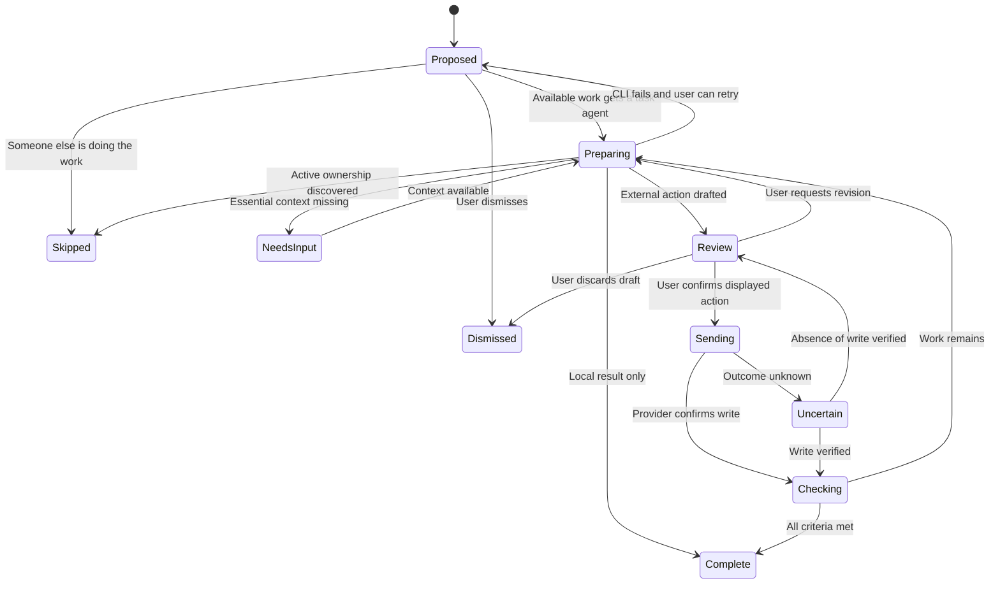

# Task discovery, preparation, and approval

**Status** — Draft. **Scope** — [US-01 through US-05 and US-13](../user-stories.md).

## Behavior

The user connects accounts and sees their connection state in the dashboard. Incoming activity and proactive review of existing activity can each surface a task. A task records its source account, a reference to the original item, the reason it surfaced, and whether a new event or a proactive review triggered it. Reprocessing the same evidence for the same follow-up updates the existing task. Dismissal persists across repeated scans of that evidence.

When a task surfaces, the agent chooses a next step and uses the local CLI to prepare the work, even while the dashboard is closed and the app is running. The user may add context, correct the approach, or dismiss the task. If essential information is missing, the agent identifies what it needs and continues with other tasks. Preparation may produce a local result, such as a summary, or one or more proposed external actions. A summary can complete the task locally. In dry mode each proposed external action waits independently for review. The preview includes the operation, sending account, recipients or target, and full content or field changes.

The diagram follows a task with a single proposed action. For multiple actions, each has its own review and delivery outcome. The dashboard identifies any still awaiting review. A confirmed write records the provider's receipt or a reference when available. A definite rejection shows the error and makes the draft available for review again. An uncertain delivery stays visible until reconciled.

## Acceptance criteria

| Scenario | Expected result |
| --- | --- |
| A Slack status request arrives with a linked issue while the app is running in default dry mode | Without a user instruction, the agent reads the issue and drafts the reply. The connector receives zero write calls. The draft is ready when the user opens the dashboard and survives a restart. |
| One task is waiting for confirmation or essential context when another actionable task arrives | The agent starts the second task on its own. The first task remains visible with the reason it is waiting. |
| A connected account loses access | The dashboard identifies the affected account and exposes a reconnect action. Other connected accounts remain usable. |
| An incoming review request is delivered twice | One task links to the request and explains its origin. |
| A proactive scan finds an unanswered thread without a new event | A suggested follow-up links to the thread and explains why it surfaced. Dismissing it and repeating the same scan leaves it dismissed. |
| The user asks for a summary, or the CLI fails during preparation | A successful summary is available locally. A failure is visible and preparation can be retried. Neither path writes to a provider. |
| Source text instructs the agent to post immediately | Preparation can produce a draft. Only explicit confirmation in the dashboard authorizes delivery. |
| The user revises the content, account, or destination | The revised action has its own preview. Any confirmation for the earlier version cannot authorize it. |
| Two actions are pending and the user confirms one twice | Only the confirmed version of that action is dispatched once. The other action stays pending. |
| A provider times out after dispatch | The dashboard shows the uncertain outcome and prevents an automatic resend that could duplicate the write. |
| A teammate says “I'm fixing this” on the linked issue | Discovery records the skipped task and links the ownership evidence. No agent starts working on the fix. If the claim arrives during preparation, stop further work and withhold pending actions for that fix. |
| A teammate is fixing the bug but asks the user to review their PR | The fix stays with the teammate. The distinct review request can become a task for the user. |

## Related contracts

[Source connectors](connectors.md) defines authentication and delivery guarantees. The [desktop runtime](desktop-runtime.md) defines polling and proactive review. The [local agent contract](local-agent.md) defines how Claude Code and Codex CLI prepare work. [Task agents and completion](task-execution.md) defines what each worker must verify. [Decision rules, writing style, and trust](delegation-and-style.md) defines clarification, readiness, and authorization beyond dry mode.
